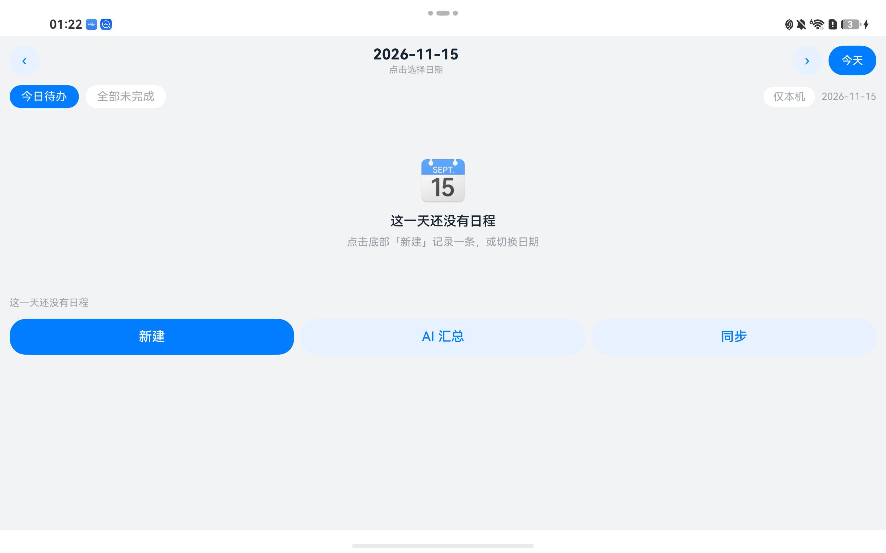

# 验证报告（VERIFICATION）

> 本文件记录**实际执行过的命令与真实输出**（2026-11-14，Asia/Shanghai）。
> 未验证项集中列在 §6，不虚报；所有产物均可在仓库根 `C:\Users\GWL\Desktop\itwillclaude\dsh-sync-suite` 重跑。

## 0. 环境与结论

| 项 | 值 |
| --- | --- |
| OS / Shell | Windows 11 + PowerShell 7（无 bash） |
| Node / pnpm / git | v24.14.0 / 11.22.0 / 2.53.0.windows.2 |
| TypeScript | 5.9.3（devDependency，仅开发期；插件运行时零 npm 依赖） |
| 结论 | **两条工程线全部交付并通过本机可执行验收**；DevEco 构建、真机 OCR/提醒、真实远端认证等本机不可执行项已在 §6 如实标注 |

验收命令与结果：

```powershell
pnpm build
# plugin build: dist/index.js + dist/client.js 已生成
# app logic tsc: exit 0
# node --check: dist/index.js / dist/client.js / .build/model/jsonl.js 全部通过
# [build] 全部构建步骤完成

node --test "packages/dsh-dots/test/*.test.mjs"
# ℹ tests 62  ℹ pass 62  ℹ fail 0

node --test "apps/arkui-schedule/tools/test/*.test.mjs"
# ℹ tests 155  ℹ pass 155  ℹ fail 0

pnpm test
# ℹ tests 217  ℹ pass 217  ℹ fail 0（62 插件 + 155 应用）

node apps/arkui-schedule/tools/validate-app.mjs
# ✅ 全部通过：8/8 条规则（JSON5/JSON 12 个、相对 import 78 条、main 静态 import 86 条、页面 4 个、rawfile/git 2 个文件）

node --check packages/dsh-dots/dist/index.js    # exit 0
node --check packages/dsh-dots/dist/client.js   # exit 0
node node_modules/typescript/bin/tsc -p apps/arkui-schedule/tools/tsconfig.json --noEmit   # exit 0
```

> 注意：Node 24.14 的 `node --test <目录>` 会把位置参数当 glob 并报 `MODULE_NOT_FOUND`（空目录同样复现）。
> 仓库脚本与文档统一改用 glob：`node --test "…/test/*.test.mjs"`。

## 1. 交付物 A：dsh-dots

### 1.1 清单与构建（BRIEF §2.1）

| 验收项 | 证据 |
| --- | --- |
| Cordis 函数插件 `apply(ctx, config)`，注册全走 `ctx.effect` | `src/index.ts:43-61`；构建 + `node --check dist/index.js` |
| `package.json` 字段（name/type/exports/dsh.bundle.patch/dsh.client/files） | `packages/dsh-dots/package.json`；`npm pack --dry-run` → **22 个文件，含 `dist/client.js`** |
| TS → dist，dist 提交、安装免构建 | `pnpm build` 实测；`dist/**` 已生成并纳入提交 |
| 运行时零 npm 依赖 | 源码非相对 import 全部为 `node:child_process|crypto|fs|fs/promises|http|os|path` |
| 不导出 `Config`、无 schemastery | `src/` 无 `schemastery`；`dist` 无该依赖 |
| 不使用 `settings.installSection` / `settings.plugin.item` | 源码检索无命中（client 测试同样断言） |
| `pnpm build` 后 `node --check` 两产物 | 均 exit 0（见 §0） |
| `dist/client.js` 为真实客户端（非占位） | 89 231 B，`client-module.test.mjs` 5 项断言 ModuleLoader/RPC/禁用 API/XSS |

### 1.2 同步引擎（BRIEF §2.3）

| 验收项 | 证据（测试/代码） |
| --- | --- |
| patch 按 entry id 逐条合并，保注释 / `!!js` / 本地独有 | `test/patch-merge.test.mjs`；真实裸仓库集成测试断言未勾选条目逐字节不变 |
| 白名单 5 类文件与 `devices/<deviceId>/` 布局 | `engine/collect.ts` + `test/integration-git.test.mjs` |
| secret 脱敏为 `__SECRET__`，restore 用本地同名字段回填 | `test/secrets.test.mjs`、`test/audit-fixes.test.mjs`；真实 profile 只读探针：`{bytes:871, stripped:0, placeholders:0, maxTokensKept:true, apiKeyEnvKept:true, roundTripIdentical:true, needsLocal:[]}` |
| 推送 = 写快照→add→commit→push；非 FF 先 `pull --rebase` ≤2 次、永不 force | `engine/git.ts`；`integration-git.test.mjs`（两设备分叉场景：B 的提交保留、rebase 后 push 成功）；`--force` 检索无命中 |
| 工作副本 `~\.dsh\dots\work\<repoHash>\` | `engine/paths.ts` |
| restore fail-closed 四层：confirm → 逐条勾选 → 写前快照（留 10 份）→ 写后 SHA-256 | `test/confirm-gate.test.mjs`（无 confirm 文件字节不变）、`test/sha-verify.test.mjs`（注入校验失败 → 快照回滚 + `E_SHA_MISMATCH`）、`test/audit-fixes.test.mjs`（未知/非法 entry 整单拒绝） |
| HTTPS token 用临时 GIT_ASKPASS（0600，不进 argv）；SSH 用系统 agent | `engine/git.ts`（`ASKPASS_SH/CMD/MJS`，token 只经 `DSH_GIT_SYNC_TOKEN` 环境变量）；审计修复测试验证含 `&|<>%^` 的 token 原样输出且 askpass 文件不含 token |
| 状态文件 `settings.json` / `credentials.json` | `engine/settings.ts`（0600 创建；审计探针确认响应/日志无 token） |
| repoUrl 仅 https/ssh/git@，deviceId 正则 | `test/audit-fixes.test.mjs`（`user:pass@` 被拒；`git@host:path`、`ssh://git@host` 放行）；路径穿越探针全拒 |

### 1.3 RPC 契约（BRIEF §2.4）

8 个 action 全部实现并逐一测试：`getState`、`saveSettings`、`testConnection`、`push`、`preview`、`apply`、
`listSnapshots`、`rollback`；响应恒 `{ok:true,data}` / `{ok:false,error:{code,message,details?}}`（HTTP 200，
鉴权失败由 `connection.requestRejection` 出 401/403）。

- 未知 action → `E_UNKNOWN_ACTION`；无 `confirm:true` → `E_CONFIRM_REQUIRED` 且不落盘；
- `preview` 返回 `sources[].entries[].status ∈ added|changed|same|manual`、`plugins{install,keep,skip,noDowngrade}`；
- `apply` 校验 previewId/sourceDevice/entries，写前快照 + 写后 SHA-256，失败回滚；
- 插件清单 MERGE-only：不降级、不删除、不执行 pnpm（写 `plugins.to-install.json` 供用户安装）；
- 写操作串行队列；preview TTL 10 分钟。
- **`getState` 只读本地、不联网**：不执行 `lsRemote`/`fetch`/`clone`；`status.reachable` 为
  `true|false|null`（null=未探测），网络探测只发生在 `testConnection`/`push`/`preview`；
  `localPending`/`remotePending` 基于本地 `origin/<branch>` 引用，无 upstream 时为 `null`；
  单次 git 网络调用 `NETWORK_TIMEOUT_MS=8000` 超时映射 `E_GIT`。
- **`apply.applied[]` 双 SHA**：`fileSha256` = 写后整个 profile patch 的 SHA-256（落盘校验），
  `blockSha256` = 该 entry 合并后文本的 SHA-256（条目追踪），不再使用含糊的 `sha256`。
  测试断言同文件多条 `fileSha256` 相同、`blockSha256` 不同且等于 `parsePatch` 该条目 raw 的 SHA。
- 独立审计者用真实临时裸仓库/临时 profile 做了 32 组探针（envelope、错误码、HTTP 200/403/405、无 confirm 不写、
  过期 previewId、只勾一条时其余字节不变、`!!js` 保留、回滚逐字节还原、119 文件全量 grep 无 token 明文）——全过。

### 1.4 设置页 UI 与资源（BRIEF §2.2/§2.5/§2.6）

- `src/client.js`：`window.__ModuleLoader__.load` + `factory(require)`；`inject:['slots','locale']`；
  `settings.section`（id `dots`，order 70）；`ctx.effect` 注册 locale；RPC 同源 fetch。
- 覆盖 BRIEF §2.5 全部 25 项（仓库配置/范围勾选/状态徽标/按钮/逐条差异勾选/插件 MERGE-only/快照回滚/内联错误/
  密码型 token）；独立审计核对 **25/25**，`client-module.test.mjs` 另有 5 项静态断言。
- 资源：`locale/en.json` + `zh.json` 各 148 key（集合一致，含 `meta.title/description/detail`）；
  原创 `icon.svg`（625 B）；插件 `README.md`（8.9 KB）；`docs/DETAIL.md`（11.8 KB）。
- 测试：`test/locale.test.mjs`、`test/client-module.test.mjs` 共 8 项全过。

### 1.5 插件测试清单（62 项）

`patch-merge` / `secrets` / `plugin-merge` / `confirm-gate` / `sha-verify` / `integration-git` /
`audit-fixes` / `state-local` / `locale` / `client-module`。集成测试使用**真实系统 git + 临时裸仓库**跑通
push → 另一设备 pull → preview → apply → rollback 全链路，不依赖网络；`state-local` 覆盖
“无工作副本/裸仓库被移走时 `getState` 仍只读本地且不产生 `E_GIT`、`reachable` 三态持久化”。

## 2. 交付物 B：arkui-schedule

### 2.1 工程与平台门控（BRIEF §3.1/§3.3）

| 验收项 | 证据 |
| --- | --- |
| ArkUI-X 工程骨架（AppScope/根与 entry build-profile、hvigorfile、oh-package、module.json5、资源） | 文件齐全；`validate-app.mjs` 规则 1/7（12 个 JSON5/JSON 可解析、引用资源存在） |
| 页面/组件 `@crossplatform` | 规则 5：所有含 `struct` 的 8 个 `.ets` 均通过 |
| Android 不编译/引用 OCR、PixelMap、Canvas 手写 | 覆盖层目录（`main` + `android`）+ 规则 4：Android 可见文件 0 命中；鸿蒙手写/OCR 只在 `entry/src/harmony/ets/**` |
| Android 静态隐藏手写入口、仅虚拟键盘 | `common/platformFeatures.ts` 默认 `handwriting:false, ocr:false`；鸿蒙覆盖层启用；Edit 页按钮受 `getFeatures().handwriting` 控制 |
| `main_pages.json`（共享 4 页）与鸿蒙超集（+`pages/Handwriting`） | 规则 3；鸿蒙清单 `entry/src/harmony/resources/base/profile/main_pages.json` |
| 相对 import 图完整 | 规则 2：78 条 import 全部解析；main 文件不依赖鸿蒙覆盖层；规则 8：main 树静态 import harmony 树即失败（动态 import 放行） |
| 平台装配（Lead P0-1） | `entry/build-profile.json5` 两 target：`default`→`sourceRoots:["./src/main","./src/harmony"]`、`android`→`["./src/main"]`；根 profile `module.targets` 用 `applyToProducts` 分别映射 default/android；运行时第二道防线 `detectPlatformFrom` + `devicePlatform.ets` 覆盖层（鸿蒙读 `deviceInfo.osFullName` 兜底 `deviceType`，检测失败 fail-closed→android）；`EntryAbility` 先同步 fail-closed 再异步检测覆盖 |

### 2.2 鸿蒙手写 + OCR（BRIEF §3.2）

- `harmony/ets/pages/Handwriting.ets` + `handwriting/HandwritingPager.ets`：Canvas 分页、`MAX_PAGES=10`、
  翻页/清空/完成并识别；`ocr/OcrBatchManager.ets`：串行（`maxConcurrency=1`）、每页
  PixelMap → **先落盘** `attachments/<sha256>.png` → `textRecognition` → 按 `pageIndex` 存 → 立即 `release`；
  整批 `init/release`；取消释放未处理 PixelMap；完成后 `concatPageTexts` 0→N 拼接、写 `AppStorage` 回填正文。
- 图表/公式：`replaceComplexBlocks` → `[公式/图表: 查看手迹]`（纯逻辑测试覆盖）；`ocr_text` 原样保留、编辑只写 `body`。
- **未验证**：OCR API 精确签名、`componentSnapshot` 对非当前页截图、PixelMap 释放时序、真机性能（见 §6）。

### 2.3 Android 功能（BRIEF §3.3）

- 共享页只用 `TextInput/TextArea`；手写/OCR 模块不在 Android 构建集合；能力注册默认关闭。

### 2.4 存储 / AI / 提醒 / Git 同步（BRIEF §3.4）

| 验收项 | 证据 |
| --- | --- |
| JSONL `devices/<deviceId>/schedules/YYYY-MM-DD.jsonl`，一行一事件、只追加 | `services/scheduleStore.ets`（`appendLineSync` 定位文件末尾、补换行、历史字节不改）；`model/jsonl.ts` + `serviceInvariants.test.mjs` 断言“追加结果以原文为前缀、不重排历史” |
| 附件 sha256 去重命名 | `model/attachments.ts` + `services/attachmentStore.ets`；测试覆盖命名/0→N 拼接/占位符 |
| 更新事件不迁日期、折叠取新版本 | `common/date.ts nextTsSameDate`（保留原日期、时刻严格递增）；`tools/test/date.test.mjs` 6 项 |
| 读其他设备目录折叠展示（fetch 后只读） | `scheduleStore.readAllDevices/readDayAllDevices/findByIdAny` + Index「含其他设备」开关 |
| 每日 AI 汇总手动触发、可取消勾选、载荷注入时间时区、只写 `ai_structured` | `model/aiPayload.ts`（11 项测试）+ `services/deepseek.ets` + Index AI 面板 |
| 提醒 reminderAgentManager ≤30，未授权降级 notificationManager；AGC 说明 | `harmony/ets/reminder/ReminderService.ets` + `model/reminder.ts`（数量上限测试）；Settings 页 AGC/签名说明 |
| isomorphic-git **真实下载** + 文件/HTTP 桥 | `rawfile/git/isomorphic-git.js` **305 157 B**（`isomorphic-git@1.25.3` UMD，VERSION/LICENSE 同目录）；`git-bridge.js` 52 751 B；`index.html` |
| 只写自己目录、永不 merge | 桥 `push` 仅 `devices/<deviceId>` add/commit；`git-bridge.test.mjs` 22 项（真实临时 git 仓库 + 系统 git，验证 init/status/log/branch、push 范围、HTTP 状态码透传、认证头、token 不外泄） |
| `GitSyncService` 与页面契约 | 固定 API（`registerProxy/configure/pull/push/status`）+ Settings 隐藏 Web 挂载 |

### 2.5 页面（BRIEF §3.5）

主页（日期选择 + 今日待办/全部未完成 + 左勾选/中标题+时间/右 📎 + 新建/AI/同步）、编辑页（四字段 +
手写切换 + 回填）、详情页（AI 结构化可编辑 + 原始 OCR 只读 + 截图全屏 + 附件哈希）、设置页
（设备标识/仓库 URL/token/AI key/同步按钮/平台信息）。`@crossplatform` 全部满足；validate 规则通过。

### 2.6 应用验收（BRIEF §3.6）

| 验收项 | 结果 |
| --- | --- |
| `tools/` 用 tsc 对模型层类型检查（stub d.ts） | `tsc -p tools/tsconfig.json` 与 `--noEmit` 均 exit 0 |
| 平台装配（Lead P0-1） | `entry/build-profile.json5` 两 target：`default`→`sourceRoots:["./src/main","./src/harmony"]`、`android`→`["./src/main"]`；根 profile `module.targets` 用 `applyToProducts` 分别映射 default/android；运行时第二道防线 `detectPlatformFrom` + `devicePlatform.ets` 覆盖层（鸿蒙读 `deviceInfo.osFullName` 兜底 `deviceType`，检测失败 fail-closed→android）；`EntryAbility` 先同步 fail-closed 再异步检测覆盖 |
| OCR 两阶段（Lead P0-2） | `model/pageCapture.ts`（main 树中性命名，无 OCR/SDK 标识符）：阶段 A 全部截图落盘 → 阶段 B 串行识别、每页立即释放、失败/取消释放未处理句柄；`pageCapture.test.mjs` 13 项，含“第 1 页 OCR 抛错时 attachments 仍为 3 且 pageIndex 0/1/2 对齐、release=[0,1,2]” |
| 服务层不变量（Lead P0-3） | `model/syncScope.ts`（设备目录断言，`GitSyncService.push` 调用）+ `syncScope.test.mjs` 13 项（`devices/pc-a-evil/`、`../`、绝对路径均拒）；`serviceInvariants.test.mjs` 11 项（JSONL 前缀追加、AI 只处理 `ai_processed:false`、`ocr_text` 逐条不变） |
| 纯逻辑覆盖：JSONL、AI 载荷、sha256、按 pageIndex 拼接、平台门控、设备路径 | **155 项测试**（sha256 11 / jsonl 14 / attachments 11 / aiPayload 11 / platform 9 / validate 22 / date 6 / git-bridge 22 / platformDetect 12 / pageCapture 13 / syncScope 13 / serviceInvariants 11） |
| 插件清单 MERGE-only 纯逻辑 | 由插件侧 `test/plugin-merge.test.mjs` 覆盖（应用不处理插件清单，见 §7 映射说明） |
| 不复制两份实现 | 模型层单一实现，Node 测试 import 编译产物 `.build/**`；页面复用同一源码 |

## 3. 其它交付（BRIEF §4）

| 交付物 | 状态 |
| --- | --- |
| 根 `README.md` | 完成（快速开始、安装、目录、覆盖摘要、边界） |
| `docs/ARCHITECTURE.md` | 完成（数据流、模块图、安全/失败模式、未验证项） |
| `docs/DATA-CONTRACT.md` | 完成（Git 目录、patch 载荷、JSONL、RPC、状态目录、应用 Git 布局） |
| `docs/CONTRACT.md` | 完成（接口/文件所有权/验收命令，执行者共用契约） |
| `devices/{pc-a,pc-b,phone-a}/` | 完成（目录说明文件） |
| `tools/init-remote-repo.mjs` | 完成并实测：临时目录 `git init -b main` + 设备目录 + 首次提交 + `git log` 正确 |

## 4. 审计驱动的修复（独立审计 → 修复 → 回归）

独立只读审计者对插件做了逐 action/字段/安全探针，发现 1 个虚假声明与 2 个硬伤、5 个重要缺陷，均已修复：

| 编号 | 缺陷 | 修复证据 |
| --- | --- | --- |
| B1 | `dist/client.js` 缺失而 README 声称已提交 | 构建脚本改为**缺 `src/client.js` 即硬失败**；`pnpm build` 生成 89 KB `dist/client.js`，`npm pack` 22 文件含之 |
| B2 | secret 子串匹配误伤 `maxTokens`/`apiKeyEnv`，回填按顺序错配 | 词边界 `isSecretKey` + 按 entry/key 回填；真实 profile 探针 3→0 替换、round-trip 字节一致；`audit-fixes` 8 项回归 |
| M1 | repoUrl 内嵌凭据 | 校验拒绝并打码（`https://user:pass@`、`https://token@`） |
| M2 | 空 repoUrl 无法保存/假成功 | 空串可保存，push/testConnection/preview 返回 `E_VALIDATION` |
| M3 | apply 非法 entry 只 skip | 整单 `E_VALIDATION`（空/未知/`same`），文件字节不变 |
| M4 | conflict / lastSyncAt 语义不符 | `state.json` 持久化；分叉才 conflict；新 service 实例可读 lastSyncAt |
| M5 | Windows askpass 经 cmd 展开 token | `askpass.cmd → node askpass.mjs`，token 仅环境变量；含 `&|<>%^` 实测原样输出 |

修复后插件测试从 44 → **62 项**，全绿；`secrets`/`sha-verify` 等原覆盖未删。

### 4.1 Lead 复审修复（第二轮）

| 编号 | 缺陷 | 修复证据 |
| --- | --- | --- |
| P0-1 | 平台装配未生效：`entry/src/harmony/ets/**` 不进鸿蒙构建 | `entry/build-profile.json5` 两 target + `sourceRoots`；根 profile `applyToProducts` 映射；运行时检测 `detectPlatformFrom` + `devicePlatform.ets`（鸿蒙 `deviceInfo.osFullName` 兜底 `deviceType`，失败 fail-closed）；validator 新增规则 8（main 静态 import harmony 即失败，动态放行）并有 fixture 单测；**sourceRoots 未在 DevEco 实测**（§6） |
| P0-2 | OCR 逐页交错，首屏失败时后续页未落盘 | `model/pageCapture.ts` 两阶段 + `OcrBatchManager` 薄适配；`pageCapture.test.mjs` 13 项，含“第 1 页 OCR 抛错：attachments=3、savedPages=3、pageIndex 0/1/2、release=[0,1,2]”；取消路径释放全部未处理句柄 |
| P0-3 | 服务不变量无可执行证据 | `model/syncScope.ts` + `GitSyncService.push` 断言（`syncScope` 13 项）；`serviceInvariants` 11 项（JSONL 前缀追加、AI 仅未处理、`ocr_text` 不变） |
| P1-1 | `getState` 每次联网、离线卡 UI | `getState` 只读本地 HEAD/state；`reachable` 三态持久化；本地 ahead/behind 用 `origin/<branch>` 引用，无则 null；`NETWORK_TIMEOUT_MS=8000`；`state-local.test.mjs` 用“裸仓库整体移走”证明 getState 仍 ok、push 才失败 |
| P1-2 | `applied[].sha256` 语义误导 | 改为 `{id,fileSha256,blockSha256,path}`；测试断言同文件多条 `fileSha256` 相同且等于整文件 SHA、`blockSha256` 不同 |
| P1-3 | 安装路径不清 | README 写清 ①GUI「Plugins → Add plugin」本地目录（链接安装，要求 `dist/` 已提交）②发布 GitHub 后走安全启动器 `install-plugin`（不接受本地目录，端点不在线时不得绕过） |
| P2 | `insert:` 多行块合并限制未文档化 | `docs/DATA-CONTRACT.md` §2.1 与插件 `docs/DETAIL.md` §4.1/已知限制写明“按内部第一个 id 整体合并”，建议一条 entry 一行 `insert` |

第二轮修复后：插件 52 → **62 项**；应用 106 → **155 项**；validate 7/7 → **8/8**；总数 **217**。

## 5. 命令输出汇总

| 命令 | 结果 |
| --- | --- |
| `pnpm build` | exit 0；dist/index.js + dist/client.js + 应用 `.build/**` 生成；3 个产物 `node --check` 通过 |
| `node --test "packages/dsh-dots/test/*.test.mjs"` | 62 pass / 0 fail |
| `node --test "apps/arkui-schedule/tools/test/*.test.mjs"` | 155 pass / 0 fail |
| `pnpm test` | 217 pass / 0 fail |
| `node apps/arkui-schedule/tools/validate-app.mjs` | ✅ 8/8 规则；JSON5/JSON 12、import 78、main 静态 import 86、页面 4、rawfile/git 2 |
| `tsc -p apps/arkui-schedule/tools/tsconfig.json --noEmit` | exit 0 |
| `node --check dist/index.js` / `dist/client.js` | exit 0 / exit 0 |
| 真实 profile patch 只读脱敏探针 | `{"bytes":871,"stripped":0,"placeholders":0,"maxTokensKept":true,"apiKeyEnvKept":true,"roundTripIdentical":true,"needsLocal":[]}` |

## 6. 未验证项与验证步骤（如实标注）

> 2026-11-19 更新：真机已连上（serial `6MFBB25C27205131`，`MLR-AL00`），下表「无鸿蒙设备」的历史判断不再成立；
> 首次真实编译 / 签名 / 安装 / 启动 / 设备验收的证据与诚实翻转见 **§14**。点按交互、OCR 端到端、第二设备同步、插件 live 仍 unverified。

| 未验证项 | 原因 | 验证步骤 |
| --- | --- | --- |
| 真机 OCR、PixelMap 截图、Canvas 手写 | 无鸿蒙设备 | 真机运行 Handwriting 页，确认每页落盘 sha256、释放 PixelMap、0→N 拼接 |
| reminderAgentManager / 通知降级 / AGC 权限 | 需 AGC 申请（约 8 工作日）+ 手动签名 | 申请 `PUBLISH_AGENT_REMINDER` 开放能力后真机创建 ≤30 条提醒并验证未授权降级 |
| Android 设备运行 | 无 Android 设备 | 用 Android 构建产物安装，确认手写入口隐藏、纯键盘输入、Git 同步可用 |
| 真实 GitHub/Gitee HTTPS/SSH 认证 | 本机无远端仓库凭据 | 建私有仓库，用 HTTPS PAT 执行 testConnection/push/pull；SSH 用 ssh-agent |
| 插件在 DSH Web GUI 的挂载与视觉 | 安装/GUI 验证由 Lead 负责（本任务禁止改 profile） | `dsh plugin --profile web add link:<repo>/packages/dsh-dots`，打开设置页确认分区与 RPC |
| `ctx.locale.t(ns,key)` 精确签名 | DSH 版本 API 细节 | 安装后观察 locale 文案；client 已做 inline 字典回退 |
| 大 base64 经 `runJavaScript` / `@ohos.net.http` 二进制与 gzip | 无真机 | 真机同步一个含二进制的私有仓库，观察 clone/push |
| rebase 冲突（同设备并发） | 集成测试只覆盖分叉非冲突 | 两设备同改同一 entry 后 push，确认 `E_CONFLICT` 提示且不丢本地文件 |

## 7. 需求 ↔ 证据映射备注

- BRIEF §3.6 列的「插件清单 MERGE-only」属于插件同步引擎语义（应用不处理 DSH 插件清单），
  由 `packages/dsh-dots/test/plugin-merge.test.mjs` 覆盖；应用侧只同步日程 JSONL 与附件。
- 应用 `.ets` **已在本机真实编译通过**（见 §8）；纯逻辑 tsc+node 测试（155 项）与静态规则校验（8 条）
  继续作为回归保障，运行时不依赖设备。
- `reports/`（执行者报告）被 `.gitignore` 忽略，属工作过程记录；本文件为对外验收证据。

## 8. 真实鸿蒙构建（2026-11-15 实测）

### 8.1 工具链

| 项 | 值 |
| --- | --- |
| IDE | `D:\A-DevEco\DevEco Studio`，DevEco Studio **26.0.0.865**（build `DS-261.23567.138.36.2600865`） |
| SDK | `sdk\default`：**HarmonyOS 26.0.0**（`apiVersion: 26`，Release） |
| 构建入口 | `devecocli`（npm `@deveco/deveco-cli@1.3.0-stable`），内部调用自带 `tools\hvigor` + `tools\ohpm` + `tools\node` + `jbr` |
| 版本对齐 | `compatibleSdkVersion` / `targetSdkVersion` = `26.0.0`（本机只装 API 26 SDK；用户确认 HarmonyOS 6+ 可接受） |

### 8.2 命令与结果（可复现）

```powershell
$env:DEVECO_CLI_STUDIO_PATH = 'D:\A-DevEco\DevEco Studio'
$env:DEVECO_SDK_HOME = 'D:\A-DevEco\DevEco Studio\sdk'
cd apps\arkui-schedule
devecocli build clean        # Clean completed successfully（停止 1 个 daemon）
devecocli build --product default
```

实测输出：

```
> hvigor WARN: No signingConfig found for product default
> hvigor BUILD SUCCESSFUL in 1 min 26 s 296 ms

entry/build/default/outputs/default/entry-default-unsigned.hap        0.87 MB
entry/build/default/outputs/default/app/entry-default.hap             0.87 MB
```

HAP **未签名**（无 AGC 签名配置），真机安装前需在 DevEco 里配 `signingConfigs` 或走自动签名。
边用电脑边构建时用 `tools/build-harmony.ps1`（处理器亲和性 + BelowNormal + JVM/Node 上限），
实测构建进程 `Affinity=0xF`、`Priority=BelowNormal`。

### 8.3 首次构建暴露并修复的 7 类问题

| # | 报错 | 根因 | 修复 |
| --- | --- | --- | --- |
| 1 | `Schema validate failed` at `app.products[1].runtimeOS` | 纯 DevEco 26 只接受 `runtimeOS: HarmonyOS | OpenHarmony`，`Android` 属 ArkUI-X 扩展 | 移除 Android product/target，另存 `build-profile.arkui-x.json5` + `entry/build-profile.arkui-x.json5` |
| 2 | `app.apiReleaseType` 不匹配 `^(Canary|Beta|Release)[1-9]\d*$` | `AppScope/app.json5` 里有旧字段 `apiReleaseType: "Release"`、`minAPIVersion/targetAPIVersion: 12` | 精简为 scaffold 形态（bundleName/vendor/versionCode/versionName/icon/label） |
| 3 | `hvigor-config.json5` does not exist | 生成工程缺 hvigor wrapper 配置 | 新增 `hvigor/hvigor-config.json5`（modelVersion `26.0.0`） |
| 4 | `Cannot find name 'crossplatform'`（6 处 + 鸿蒙覆盖层 2 处） | `@crossplatform` 是 ArkUI-X 装饰器，纯 HarmonyOS 编译器不定义 | 新增 `tools/set-build-mode.mjs`：纯鸿蒙模式移除、ArkUI-X 模式自动加回；validator 规则 5 改为按模式校验 |
| 5 | `arkts-no-spread`（Index/Detail 3 处 `{...record}`） | ArkTS 禁止对象展开 | `model/types.ts` 新增 `cloneRecord()` 逐字段复制，调用处改为「克隆 + 改字段」 |
| 6 | `arkts-no-structural-typing`（GitSyncService 2 处 reject） | `Error` 是接口，类实例赋值触发结构化类型检查 | `PendingRequest.reject` 与 Promise executor 的 reject 参数改为 `Object` |
| 7 | `arkts-no-untyped-obj-literals`（Settings）、`WebAttribute.onError` 不存在 | `Record<string,string>` 字面量 + 旧版 Web 回调 | 改显式 if/else；`.onError()` → `.onErrorReceive()` |

### 8.4 构建后的回归

```
node tools/validate-app.mjs                  # ✅ 8/8（JSON5 17、import 78、main 静态 import 88、页面 4、rawfile 2）
node --test apps/arkui-schedule/tools/test/*.test.mjs   # 155 pass / 0 fail
.\node_modules\.bin\tsc -p apps/arkui-schedule/tools/tsconfig.json --noEmit   # exit 0
```

### 8.5 仍未验证（构建已通过，但运行时仍需设备）

- ~~HAP 未签名，真机安装需 AGC 签名配置~~ → 已在 §10 打通（签名 HAP 已装到 `MLR-AL00` 并启动）；
- 真机 OCR / `componentSnapshot` / PixelMap 释放 / 提醒权限（AGC，约 8 工作日）；
- Android 分支：本机无 ArkUI-X 工具链，`architecture-x` 变体只做了静态校验，未编译；
- `source.sourceRoots` 在 HarmonyOS build 中已被 hvigor 接受（本次构建通过），
  但其「同名相对路径后者覆盖前者」的语义是否与 ArkUI-X 一致，仍需在 ArkUI-X 工具链下复核。

## 9. Android APK 真实构建（2026-11-15 实测）

### 9.1 工具链（全部本机安装并验证）

| 组件 | 位置 / 版本 |
| --- | --- |
| DevEco Studio | `D:\A-DevEco\DevEco Studio` 26.0.0.865 |
| ArkUI-X SDK | `%LOCALAPPDATA%\ArkUI-X\Sdk\26.0.0\arkui-x`，**26.0.0.28 (Beta2)**（DevEco 插件下载） |
| ACE Tools | 同上 `toolchains\bin\ace.cmd`（`ace config` 已配置 SDK/JDK/Node/ohpm 路径） |
| Android SDK | `D:\android-sdk`：platform-tools、platforms android-33/34、build-tools 30.0.3/34.0.0 |
| Gradle | wrapper 8.4（`repo.huaweicloud.com`）+ 本机 8.7 备用 |
| JDK | **Temurin 17.0.21**（`D:\jdk17\jdk-17`）——DevEco 自带 JBR 是 **JDK 25**，Gradle 8.4 无法运行（`Unsupported class file major version 69`） |

### 9.2 命令与结果（可复现）

```powershell
$sdk = "$env:LOCALAPPDATA\ArkUI-X\Sdk\26.0.0\arkui-x"
$env:PATH = "$sdk\toolchains\bin;D:\A-DevEco\DevEco Studio\tools\node;$env:PATH"
$env:JAVA_HOME = 'D:\jdk17\jdk-17'
$env:ANDROID_HOME = 'D:\android-sdk'

cd apps\arkui-schedule
node tools\set-build-mode.mjs --mode arkui-x   # entry 只编 src/main（无手写/OCR）
ace build apk --debug
```

实测输出：

```
Use ArkUI-X SDK, Version 26.0.0.28
> Task :app:assembleDebug
BUILD SUCCESSFUL in 1m 44s
31 actionable tasks: 31 executed
APK file built successfully.
```

产物：

```
apps/arkui-schedule/dist-android/arkui-schedule-android-debug.apk   50.84 MB
  = .arkui-x/android/app/build/outputs/apk/debug/app-debug.apk
  ArkUI-X 运行库：lib/arm64-v8a/libarkui_android.so 等 20+ 个 .so + classes.dex 557 KB
  含 Handwriting / OcrBatch / reminderAgent 的条目：0（Android 分支物理上不含这些代码）
```

### 9.3 打通 Android 构建时修掉的问题

| # | 现象 | 根因 | 处理 |
| --- | --- | --- | --- |
| 1 | `ace modify` 交互式命令在无 stdin 时崩溃 | readline 被关闭 | 新增 `tools/ace-driver.cjs`，用管道喂 `2`（Android 平台） |
| 2 | `must be equal to one of the allowed values` at `products[1].runtimeOS` | ArkUI-X 的 hvigor 仍按 HarmonyOS schema 校验 | 根 profile 只保留 HarmonyOS product；Android 差异只放在 entry 的 `sourceRoots` |
| 3 | `Cannot find name 'crossplatform'` | ArkUI-X 26 的 ets-loader 不认该装饰器（文档里的 `@crossplatform` 只是 API 能力标签） | 两种模式都清除该装饰器，validator 规则 5 改为「出现即失败」 |
| 4 | `The module target 'ohosTest' is not found` | `ace build apk` 无条件编译 ohosTest | entry profile 增加 `ohosTest` target + `entry/src/ohosTest/module.json5` + 最小 `List.test.ets` |
| 5 | `@ohos/hypium` 无法解析 | 测试模块依赖缺失 | `oh-package.json5` devDependencies 增加 `@ohos/hypium 1.0.25` |
| 6 | ACE 打包 ENOENT：`.arkui-x/ios/.../pkgContextInfo.json` | ACE 的复制逻辑对 iOS 目录不 mkdir | 预建 `.arkui-x/ios/arkui-x/{entry,entry_test}` |
| 7 | Gradle 启动失败 `Unsupported class file major version 69` | DevEco JBR 是 JDK 25，Gradle 8.4 不支持 | 安装 Temurin 17，`JAVA_HOME` 指向它，`ace config --java-sdk` 同步 |

### 9.4 双产物与模式切换

| 产物 | 构建模式 | 命令 | 结果 |
| --- | --- | --- | --- |
| HarmonyOS HAP | `--mode harmony`（entry = main + harmony） | `devecocli build --product default` | `entry-default-unsigned.hap` 0.87 MB，BUILD SUCCESSFUL |
| Android APK | `--mode arkui-x`（entry = main only） | `ace build apk --debug` | `app-debug.apk` 50.84 MB，BUILD SUCCESSFUL |

`tools/set-build-mode.mjs` 会同时切换：根/entry 的 build-profile、两个 hvigorfile（内置任务 ↔ ArkUI-X 任务）、
hvigor 插件依赖，并清理/保留 `@crossplatform`。

### 9.5 仍未验证

- APK **未在 Android 真机/模拟器上安装运行**（本机无 Android 设备；`adb devices` 为空）；
- 手写/OCR 在 Android 上不存在的结论来自「源码隔离 + APK 内容扫描」，未做运行时点击验证；
- ~~HarmonyOS HAP 仍未签名（需 AGC 证书/profile，等设备连接后由 `tools/install-device.ps1` 生成）~~
  → 已在 §10 完成签名 + 真机安装 + hilog/UI 验证。

## 10. 签名与真机安装（2026-11-15 实测）

§8 留下「HAP 未签名、无设备」的尾巴，本节把它补齐：**签名 → 构建 → 安装 → 启动 → hilog → UI 节点** 全链路已在真机上跑通。

### 10.1 工具链与设备

| 项 | 值 |
| --- | --- |
| IDE | `D:\A-DevEco\DevEco Studio`，DevEco Studio **26.0.0.865** |
| HarmonyOS SDK | `D:\A-DevEco\DevEco Studio\sdk\default`（API **26**） |
| hdc | `...\sdk\default\openharmony\toolchains\hdc.exe`（Ver **3.2.0f**） |
| 签名工具 | `...\sdk\default\openharmony\toolchains\lib\hap-sign-tool.jar` |
| JDK | `D:\jdk17\jdk-17`（Temurin **17.0.21**；不能用 DevEco 自带 JDK 25） |
| 构建/签名入口 | `C:\Users\GWL\Desktop\itwillclaude\.tmp\deveco-cli\node_modules\.bin\devecocli.cmd` |
| 华为账号 | `行走的49W 丁浩然`（主账号，已认证），developer-id / team `70086000166631503` |

实测连接的设备：

| 项 | 值 |
| --- | --- |
| serial | `6MFBB25C27205131` |
| 型号 | MatePad Mini 悦读版 `MLR-AL00` |
| 系统 | `const.ohos.apiversion=26`，`const.ohos.fullname=OpenHarmony-7.0.0.111` |
| UDID | `A2DCA977DA029D56868CBA60A01A698B677DB1BA1101B5499A43999D8B6CC07E` |

### 10.2 失败起点：DEVICE_MISSING 与真正根因

第一次尝试是让 CLI 全自动生成签名（期望它自己建 Profile）：

```powershell
devecocli signature generate --product default --force
```

实测失败：

```
[DEBUG] [EnvCheck] Scenario 4 Device check: no cloud devices found, falling back to local hdc
[DEBUG] [EnvCheck] Scenario 4 Device check: local device found but not an emulator
[Debug] FAIL: DEVICE_MISSING "Unable to create the profile file due to missing devices..."
```

真正根因**不在设备侧**：AGC 团队下既没有 HarmonyOS 应用、也没有登记过设备。
`devecocli` 只读 AGC、不写 AGC，因此它无法替你创建应用、证书和 Profile，自然「找不到设备」。
设备本身、hdc 授权、开发者模式当时都是正常的（hdc 能连上、能装包）。

结论：**签名材料必须先在 AGC 网页侧备齐**，CLI 只负责在材料齐备后签发本地密钥与配置。

### 10.3 AGC 手工申请四步

先在 [AppGallery Connect](https://developer.huawei.com/consumer/cn/service/josp/agc/index.html) 手工完成四件事，对象如下：

| 对象 | 标识 / 值 |
| --- | --- |
| 应用 | `itwill schedule`，包名 `com.itwill.schedule`，支持设备「手机 + 平板」，所属项目 `itwill-schedule` |
| appId | `6917621854545473037` |
| projectId | `101653523865711182` |
| 调试证书 | `itwill-debug-cert`（类型「调试证书」，状态生效，失效 **2027-11-15**），由 `signing/itwill-debug.csr` 上传签发 |
| 设备 | `MLR-AL00`（类型「平板」，注册时间 2026-11-15 13:01:59） |
| 调试 Profile | `itwill-debug-profile`（类型「调试」，provisionId `2084126670842794816`，uuid `5657b004-aa48-45c2-b598-bedaf8aa0379`） |

四个步骤（顺序不能乱：证书要绑应用，Profile 要绑证书 + 设备）：

1. **建应用**：项目 `itwill-schedule` → 添加 HarmonyOS 应用，包名 `com.itwill.schedule`，支持设备勾选手机 + 平板。
2. **传 CSR 签证书**：`证书、APP ID 和 Profile` → 证书 → 新增「调试证书」，上传 `apps/arkui-schedule/signing/itwill-debug.csr`，
   签发得到 `itwill-debug-cert`（下载为 `itwill-debug.cer`）。
3. **登记设备 UDID**：设备管理 → 添加设备，填 §10.1 表里的 UDID，设备形态选「平板」。
4. **建调试 Profile**：Profile → 新增「调试」，选上面签好的证书、勾选刚登记的设备，得到 `itwill-debug-profile`（下载为 `itwill-debug.p7b`）。

实测遇到的两个 AGC 页面细节：

- **①「类型」下拉里没有「调试设备」**。新版设备页只有 手机 / 平板 / PC / 2in1 / 运动手表 / 智能手表 / 智慧屏 / 路由器，
  按设备**形态**选「平板」即可，这样它才会出现在调试 Profile 的设备勾选列表里。
- **② Profile 行的「下载」按钮抓不到文件**。它的实现是 `window.open(OBS 签名直链)`，常规下载监听收不到；
  需要从页面 XHR 里取直链（`provision/refresh` → `cfs/file_service/v1/download/object/url`）再自己下载。

### 10.4 登记设备后自动签名恢复可用

AGC 四步做完后，**同一条命令原样重跑即成功**，不需要改任何参数：

```powershell
devecocli signature generate --product default --force
```

实测输出：

```
Start generating p12
Start generating csr
Start generating certificate
Start generating profile
Signing config written to C:\Users\GWL\Desktop\itwillclaude\dsh-sync-suite\apps\arkui-schedule\build-profile.json5
Signature generation completed successfully.
```

它会：

- 在 `%USERPROFILE%\.ohos\config\` 下生成 `default_arkui-schedule_*.{p12,cer,p7b}`；
- 把 `signingConfigs` 写进 `apps/arkui-schedule/build-profile.json5`；
- 之后 `devecocli build` / `hvigor` 就会自动签出 `entry-default-signed.hap`（实测 953,680 B）。

⚠️ **它签发的证书与 `signing/itwill-debug.cer` 不是同一张**（实测两者 cer 的 SHA256 不同）。
两条身份线并存会引出 §10.7 的 `install sign info inconsistent`。

### 10.5 hvigor 只接受加密密码 → 离线签名脚本

自动签名把机器相关的加密串写进了 `build-profile.json5`，不适合提交。手工换成明文密码再构建，直接失败：

```
> hvigor ERROR: Failed :entry:default@SignHap
00303116 Configuration Error
Error Message: The length of the storePassword or keyPassword field in the signature configuration is less than 32. At file: ...\apps\arkui-schedule\build-profile.json5
```

结论：hvigor 的 `SignHap` 只认 DevEco **加密后**的密码串（64 位 hex），明文不可用。
因此仓库里的 `build-profile.json5` 保持 `"signingConfigs": []`（不提交机器相关的加密串），
签名改由离线脚本 `apps/arkui-schedule/tools/sign-hap.ps1` 完成：直接用 SDK 的 `hap-sign-tool.jar` +
明文密码 + 仓库内 `signing/` 材料，绕开 hvigor。

脚本参数（`apps/arkui-schedule/tools/sign-hap.ps1`）：

| 参数 | 默认值 | 说明 |
| --- | --- | --- |
| `-Hap` | `entry\build\default\outputs\default\entry-default-unsigned.hap` | 待签名的未签名 HAP |
| `-Out` | 输入名 + `-signed.hap` | 输出路径 |
| `-KeyAlias` | `debugkey` | p12 别名 |
| `-StorePass` / `-KeyPass` | `<已脱敏>` | 明文口令（与 `signing/README.md` 一致） |
| `-CompatibleVersion` | `26` | 与 API 26 对齐 |
| `-SkipVerify` | 关 | 跳过 `verify-app` 校验 |

### 10.6 构建 / 签名 / 安装 / 启动命令与输出

```powershell
cd apps\arkui-schedule

# 1) 构建（限制 4 核 + BelowNormal，边用电脑边构建）
powershell -File tools\build-harmony.ps1 -Cores 4

# 2) 离线签名 + 自校验
powershell -File tools\sign-hap.ps1

# 3) 安装（覆盖安装；注意 §10.7 的坑）
hdc -t 6MFBB25C27205131 install -r entry\build\default\outputs\default\entry-default-unsigned-signed.hap

# 4) 启动
hdc -t 6MFBB25C27205131 shell aa start -a EntryAbility -b com.itwill.schedule
```

实测输出：

```
# 构建
> BUILD SUCCESSFUL in 10 s 310 ms（42 tasks）
entry\build\default\outputs\default\entry-default-unsigned.hap   912,422 B

# 签名
sign-app success
signed HAP: entry-default-unsigned-signed.hap (953,791 bytes)

# 校验（sign-hap.ps1 内自动执行 verify-app）
Digest verify result: true, DigestAlgorithm: SHA-256
verify permission sign success
verify: Verify success
verify-app success（exit 0）

# 安装
msg:install bundle successfully.

# 启动
start ability successfully.
```

### 10.7 两个安装坑

| # | 现象 | 根因 | 处理 |
| --- | --- | --- | --- |
| 1 | `msg:error: failed to install bundle. code:9568332 error: install sign info inconsistent.` | 设备上已装的是 `devecocli` 自动签发身份签的包，与 `signing/itwill-debug.cer` 不是同一张证书 | 先 `hdc -t 6MFBB25C27205131 uninstall com.itwill.schedule` 再装，实测成功 |
| 2 | `hdc install` 失败时退出码仍为 `0`（`$LASTEXITCODE=0`） | hdc 的 CLI 行为：失败只体现在输出文本 | **必须看输出文本**（`install bundle successfully`）判断成败，不能只看退出码 |

### 10.8 hilog 15 秒观察结论

冷启动观察命令（实测）：

```powershell
hdc -t 6MFBB25C27205131 shell aa force-stop com.itwill.schedule
hdc -t 6MFBB25C27205131 shell hilog -r          # 清缓冲
hdc -t 6MFBB25C27205131 shell aa start -a EntryAbility -b com.itwill.schedule
# 等 15 秒
hdc -t 6MFBB25C27205131 shell hilog -x > hilog-final.txt
```

结论：

- 采集 **1722 行**日志；`jscrash|appfreeze|Fatal|SIGSEGV|SIGABRT` 命中 **0**；
- 15 秒后进程 `com.itwill.schedule` **仍存活**（PID 26968）；
- 应用侧 **31 条 E 级**日志全部是框架噪声，不构成崩溃证据：
  `CODE_SIGN [XpmIoctl] Ioctl cmd ... failed: Invalid argument (ignore)`、
  `WMS SetWindowType: permission denied!`、
  `ArkCompiler PandaFileSnapshotInterfaces::ReadCrossBundleHspInfo failed`、
  `data_share_manager_impl RegisterClientDeathObserver failed`、
  `Ace LoadThemeFont: Failed to load font default.ttf`、
  `AceAppBar read abc file success!`（这条虽是 E 级，语义是成功）；
- 日志里另有 2 条 `OnProcessDied`（`com.huawei.hmos.clouddrive`），与本应用无关；
- `/data/log/faultlog/faultlogger/` 在本机 shell 下 `Permission denied`，取不到 faultlogger 文件，
  因此本节的判据是「hilog 无 jscrash / appfreeze + 进程存活」，**不是** faultlog 为空。

### 10.9 UI 实证

设备锁屏时 `devecocli ui layout` 只能拿到锁屏节点（`ScreenLockRootComponent`），必须先唤醒并解锁：

```powershell
hdc -t 6MFBB25C27205131 shell power-shell wakeup
hdc -t 6MFBB25C27205131 shell "uitest uiInput swipe 1280 1400 1280 300 300"
```

然后再取节点树：

```powershell
devecocli ui layout --device 6MFBB25C27205131 --format json --mode simplified
```

实测拿到 2560×1600 的真实页面节点，文本为：`2026-11-15`、`点击选择日期`、`今天`、`今日待办`、
`全部未完成`、`仅本机`、`这一天还没有日程`、`点击底部「新建」记录一条，或切换日期`，
按钮 `新建` / `AI 汇总` / `同步`。

截图（`hdc shell snapshot_display -f /data/local/tmp/itwill.jpeg` + `hdc file recv` 取回）：



文件：`docs/images/harmony-device-run-2026-11-15.jpeg`，2560×1600，107,467 B。

### 10.10 仍未验证与边界

- **release 证书未做**：本节全部基于「调试证书 + 调试 Profile」，只能装到已登记 UDID 的设备上；
- **调试身份不可上架**：`itwill-debug.cer` / `itwill-debug.p7b` 是调试用途，不能用于应用市场发布；
- **换设备要重新登记**：Profile 绑定 UDID，换一台设备必须回 AGC 重新登记 UDID 并重建调试 Profile，否则安装失败；
- **有效期**：调试证书与 Profile 均到 **2027-11-15**，到期需重签并同步更新仓库内 `signing/`；
- **faultlog 目录无权限**：`/data/log/faultlog/faultlogger/` 在本机 shell 下 `Permission denied`，崩溃判定依赖 hilog 与进程存活；
- **未做多设备 / 多分辨率验证**：只测了 `MLR-AL00` 一台（2560×1600 平板），手机形态与其它分辨率未验证；
- `apps/arkui-schedule/tools/install-device.ps1` 本次**未使用**（安装走的是直接 `hdc install`），其行为未验证。

## 11. 手写板功能与产物级验收（2026-11-15 实测）

### 11.1 团队须知：为什么「源码测试全绿 + BUILD SUCCESSFUL」但产物缺功能

这是本轮最重要的教训，**验收口径的失误**，必须记住：

| 环节 | 当时看到的 | 实际情况 |
| --- | --- | --- |
| `node --test` | 218→306 全绿 | 测的是 `src/main` 的纯逻辑，**没测产物内容** |
| `hvigor` 输出 | `BUILD SUCCESSFUL` | 只代表编译了 `aceModuleRoot` 里的东西 |
| 解包 HAP | —— | `main_pages.json` **只有 4 页**（无 `pages/Handwriting`），`modules.abc` 里 `Handwriting`/`hw-page-`/`PageBook`/`OcrBatch` 命中 **0** |

两个原因叠加：

1. **`.arkui-x/arkui-x-config.json5` 里的 `{crossplatform:true}`**：它会让 hvigor 判定这是 ArkUI-X 工程，
   进入 crossplatform 模式 —— `aceModuleRoot` 固定 `entry/src/main/ets`、`@kit.CoreVisionKit` 被
   `can't support crossplatform application` 拦下、**`src/harmony/**` 整棵不参与编译**。
2. **`entry/build-profile.json5` 的 `targets[].source.sourceRoots` 对 entry 模块不生效**：
   查 hvigor 插件源码（`src/utils/source-roots-utils.js`）可见它只用于**依赖的 HAR/HSP**，
   对 entry 自己的 ets 源根无效。之前"构建接受了这个字段"只是没报错，不代表生效。

=> 结论：**构建通过 ≠ 交付通过**。任何"鸿蒙专属代码"必须以产物内容为准。

### 11.2 修复：文件级覆盖 + 交叉平台开关 + 产物断言

| 机制 | 文件 | 说明 |
| --- | --- | --- |
| 覆盖层 | `apps/arkui-schedule/tools/overlay.mjs` | `apply`：把 `entry/src/harmony/**` 按相对路径复制到 `entry/src/main/**`（被覆盖的写进 `.platform-overlay/backup/`、新建的记账）；`restore`：逐字节还原并删除新建文件。**可逆、不污染工作区** |
| 交叉平台开关 | `tools/set-build-mode.mjs` | harmony 模式把 `.arkui-x/arkui-x-config.json5` 改名 `.harmony-off`（并去掉 `local.properties` 的 `arkui-x.dir`）；arkui-x 模式再放回 |
| 产物断言 | `tools/verify-hap.mjs` | 自带 ZIP 解析（无依赖）。鸿蒙：`main_pages.json` 必须含 `pages/Handwriting`，`modules.abc` 必须含 `Handwriting`/`hw-page-`/`PageBook`/`OcrBatch`，且含 Pen Kit 或 OCR 符号；APK：上述符号必须 **0 次** |
| 流水线 | `tools/build-harmony.ps1` | `apply overlay → devecocli build → restore overlay → verify-hap`；构建失败也会 restore |

实测输出（2026-11-15 15:14）：

```
> hvigor BUILD SUCCESSFUL in 26 s 996 ms
已还原：删除 5 个新建文件、写回 3 个备份文件

== verify HAP contents ==
产物：…\entry-default-unsigned.hap（1267692 B，13 个条目，模式 harmony）
  ✓ main_pages.json 含 pages/Handwriting（108 B）
  ✓ modules.abc 含 Handwriting（16 次）
  ✓ modules.abc 含 hw-page-（1 次）
  ✓ modules.abc 含 PageBook（2 次）
  ✓ modules.abc 含 OcrBatch（7 次）
  ✓ 含手写/OCR 能力痕迹（Pen Kit 3 次 / OCR 3 次）
✓ 产物验收通过
```

顺带修掉的真编译错误：`platformFeatures.ts` 里从 `.ts` import `.ets`（`ReminderService`）被 ArkTS 禁止
（`Importing ArkTS files in JS and TS files is forbidden`）→ 两棵树里都改名为 `platformFeatures.ets`。

### 11.3 手写板功能（本轮实装）

| 能力 | 实现要点 | 纯逻辑（Node 可测） |
| --- | --- | --- |
| 可选分页（默认 1 页，上限 10） | `PageBook`：页序 → 画布槽位映射，删中间页后其余页笔迹跟随；`HandwritingPagerState` 用扁平字段同步给 ArkUI | `model/pageBook.ts`（16 用例） |
| 页条 | 画布上方页码块 + 「＋」，当前页高亮，点页码跳页 | — |
| 框选（框内不 OCR） | overlay 是笔迹 Canvas 的**兄弟节点**（截图只截 `hw-page-<slot>`，框/手柄/× 不进图）；归一化坐标 0..1 → `fillRect` 填白 | `model/regions.ts`（17 用例） |
| 两阶段识别 | 阶段 A 逐页截图落盘 `attachments/<sha256>.png`（**先全部落盘**）→ 阶段 B 有框页 `release → maskPage → 二次截图 → recognize`，无框页直接识别 | `model/pageCapture.ts`（22 用例） |
| 正文拼接 | `composePageBody`：每页文字（`replaceComplexBlocks` 降级表格公式）+ 该页占位符 `[图表/公式: 查看手迹 · 第N页·区域K]`（按 y 升序） | `model/attachments.ts` |
| 笔工具 | 5 笔刷（钢笔/圆珠笔/铅笔/马克笔/荧光笔）+ 5 档粗细（2/3.5/5/7/10）+ 5 色 + 橡皮（`destination-out`，宽度×4）+ 撤销/重做（按页、≥20 步） | `model/brush.ts`（25 用例）、`model/strokeHistory.ts`（14 用例） |
| 唯一完成入口 | 底部 **「完成（统一识别）」**，无"翻页即识别"路径；`ocr_text` 只保留遮罩图识别文本，正文另加占位符 | — |

测试总数：`node --test` **306 pass / 0 fail**（原 218 + 88 新增），`validate-app.mjs` 8/8。

### 11.4 仍未验证 / 已知取舍

- **真机手势与渲染未验**（验证时平板处于锁屏 PIN 界面，`aa start` 报 `10106102`）：落笔、铅笔抖动、
  钢笔速度调制、橡皮擦除观感、框选手势命中、`componentSnapshot` 是否真的不含 overlay、填白后重绘是否够一帧；
- 马克笔/荧光笔是**逐段描边**，半透明笔刷在接缝处会重复叠加偏深（取舍：不每帧整页重绘）；
- 「一笔成形」（停顿 600ms 判定直线/矩形/圆）只留 `TODO`，未实现；
- `StrokeHistory` 没有 `redoDepth`，「重做」只有可用/不可用，没有步数；
- 填白是**破坏性**的（抹掉框内笔迹），依赖"阶段 A 已先落盘原图"这一顺序保证；取消整批时不会恢复画布。

## 12. Pen Kit 评估与手写板定版（2026-11-15 实测）

### 12.1 Pen Kit spike：不通过（已回退自研）

`@kit.Penkit` 在本机 SDK 里存在（`sdk/default/hms/ets/kits/@kit.Penkit.d.ts` → `@hms.stylus.HandwriteComponent.d.ets`，
API 26 声明齐全，`tablet-hmos.json` 也声明了 `SystemCapability.Stylus.Handwrite`），但真机 spike 在第 2 项失败：

```
E ArkCompiler: TypeError: Cannot read property createSystemHspModuleResourceManager of undefined
    at initPaintView (penkit|penkit|1.0.0|.../HspPaintController.ts:15:1)
    at PaintController (penkit|@hw-penengine/library|1.0.20240621|.../PaintController.ts:189:14)
    at HandwriteController (penkit|penkit|1.0.0|.../HandwritePaint.ts:373:1)
    at PenKitSpike entry (.../PenKitSpike.ets:27:45)
E AceRouter: failed to create page: pages/PenKitSpike
```

`new HandwriteController()` 依赖 Pen Kit 自带 HSP 模块的资源管理器，普通 entry 应用（系统 hms 包形态）取不到；
要修就得把 Pen Kit 的 HSP 作为依赖正确接入，属文档外的逆向。按 gate 规则**停止改造、回退自研**。

> 结论（写进设计取舍）：**`@kit.Penkit` 是闭源系统组件，不能 fork/修改**，只能用其公开 props
> （`defaultPenType` / `defaultPenInfo` / `hiddenTools` / `widthRatio` / `heightRatio` / `maxCanvasHeight` / `scaleDisabled`）；
> 我们选择仿制其交互而非集成，是因为它没有分页概念、存专有笔记文件、导出图片能否用于 OCR 未验证，
> 与"分页 + 逐页截图 + 框选遮罩"链路冲突。

### 12.2 手写板定版（自研，真机验证）

工具条 9 个位置（竖屏顶部横排 ≤48vp；横屏左侧竖排 rail ≤56vp）：

```
[笔形▾] [粗细▾] [颜色▾] [橡皮] [手动框] [撤销] [重做] [− n/m +] [完成]
```

- 笔形按钮显示**当前笔刷名 + ▾**（钢笔/圆珠笔/铅笔/马克笔/荧光笔），粗细显示**当前档位圆点 + 数值 + ▾**，
  颜色显示 20×20 色块 + ▾；按钮宽度**按内容自适应**（`minWidth(44)` + 左右 8vp padding，`flexShrink(0)`），
  整行 `Scroll` 横向滚动（溢出就滚、不换行、不压缩、不省略、禁 `TextOverflow.Ellipsis`）。
- 二级面板是**绝对定位浮层**（`minWidth(140)`，行高 44），不挤压画布、不遮画布中心。
- 步进器 `− n/m +`：`−` = 删除当前页（**两次确认**，只剩 1 页置灰）；`+` = **在当前页之后插入**空白页并跳转（上限 10）。
- 页用**稳定 id**（`p1/p2…`，`pageBook.ids`），插页/删页时笔迹、框、撤销历史、截图 id 一起跟随；占位符「第N页」用显示顺序。
- 「清空本页」已删除（用户要求：删除就够了），代码与 UI 里 `清空` 字样零命中。
- 首次进入弹一次引导（`preferences` 的 `handwriting.tipShown`），之后不再出现；页面无常驻提示与开发期文案。

真机 layout 证据（`devecocli ui layout`，1600×2560 竖屏）：

```
钢笔 @38,138→105,185   ▾ @110,138    3.5 @195,138→241,185  ▾ @246,138
(色块) ▾ @359,138      橡皮 @402,114→507,209   手动框 @516,114→654,209
↶ @664,114→769,209     ↷ @778,114→883,209      − @893,114→988,209
1/1 @988,114→1121,209  + @1121,114→1216,209    完成 @1429,114→1581,209（152px）
Canvas hw-page-p1: 0,218 → 1600,2494（高 2276/2560 = 88.9% 屏高）
```

菜单（点开后 `ui layout` 里可见）：笔形 `钢笔 ✓ / 圆珠笔 / 铅笔 / 马克笔 / 荧光笔`；
粗细 `2 vp / 3.5 vp / ✓ / 5 vp / 7 vp / 10 vp`。hilog 自证：`[hw] menu=brush open=1` / `[hw] menu=size open=1`。

### 12.3 端到端真机验证（写→框→完成）

操作：首页「新建」→「手写板」→ `uitest uiInput swipe` 写 2 笔 → 点「手动框」→ 拖一个框 → 点「完成」。

结果（回到编辑页后的 `ui layout`）：

```
正文
[图表/公式: 查看手迹 · 第1页·区域1]     ← 占位符写入正文
手迹附件（1 页）
```

hilog 同时出现真实 OCR 引擎日志（证明不是假通过）：

```
hiai.vision/OCR_LIB_MSG: LoadDetectModel::end : 195.08 ms
hiai.vision/OCR_LIB_MSG: InitLibrary::ocr finish : 205.51 ms
```

进程始终存活（同 PID），无 jscrash/appfreeze。截图：
`docs/images/ui-index-portrait.jpeg`、`ui-handwriting-portrait.jpeg`、`ui-handwriting-toolbar-menu.jpeg`、
`ui-edit-handwriting-result.jpeg`。

### 12.4 未验证 / 边界

- **横屏截图没取到**：`uitest uiInput` 无 `rotate` 命令、设备无 `wm`、`devecocli ui window` 只能 list；
  `orientation: auto_rotation` 只能等用户开系统自动旋转后物理横屏验证。仓库里的
  `ui-index-landscape.jpeg` 是**旋转失败**的那张（内容与竖屏相同），已如实标注，不当作横屏证据。
- 压感/铅笔抖动的手感只有"真机写过、不崩"这一级结论，缺少笔尖压力与视觉评估（工具注入无法产生压感）。
- 多分辨率/手机形态未验（只测 MLR-AL00 一台 1600×2560 平板）。
- AI 三个源的真机「测试」未做（没有可用 key）。


## 13. 收口批次（2026-11-15 夜）：笔迹设置 / 主从布局 / 附件 zip / 未完成索引 / 日程桥

### 13.1 产物

| 产物 | 大小 | SHA256 |
| --- | --- | --- |
| `dist-harmony/arkui-schedule-harmony-debug-signed.hap` | 2,133,649 B | `E7E8245CB542ED2E7316DD6C62D073DEABDEF0858DB2F91263F919F98BE662A3` |
| `dist-android/arkui-schedule-android-debug.apk` | 53,628,063 B | `FE20B6D7830C8F6B3583A552EEA4876D1F331EF93BC2CB781C111C2295C3AF9C` |

回归：App `node --test` **704 pass / 0 fail**；插件包 **98 pass / 0 fail**；`validate-app` **8/8**；
`verify-hap`（鸿蒙）`pages/Handwriting` + `Handwriting` 16 次 / `hw-page-` 1 / `PageBook` 2 / `OcrBatch` 7；
`verify-hap --apk` **6/6**（无 Handwriting / OcrBatch / recognizeText / PenKit / hw-page- / HandwriteComponent）。

### 13.2 真机已验（MLR-AL00，1600×2560 与 2560×1600，2026-11-15）

- **笔迹设置合并菜单**：工具条只剩 `‹ | 钢笔 · 3.5 · 黑 ▾ | 橡皮 | 手动框 | ↶ | ↷ | [−|+] [1/1] [‹|›] | 完成`；
  点开后三段齐全（实测 bounds：`笔形` 19,296 / `粗细` 19,581 / `颜色` 19,754，5 笔刷 + 5 档 + 5 色全部可见）；
  选「圆珠笔 + 5 + 红」→ 按钮文案变 `圆珠笔 · 5 · 红` 且**面板不关**（hilog `[hw] ink … panel=open`）。
- **分页三单元格（横屏）**：`−`@0,988→84,1083 与 `+`@87,988→171,1083 同格；`1/1`@0,1087→171,1182；
  `‹`@0,1187→84,1282 与 `›`@87,1187→171,1282 同格；`完成`@0,1411→171,1516 固定底部**可见**。
- **分页三单元格（竖屏）**：`−`@1144 / `+`@1188 / `1/1`@1239 / `‹`@1334 / `›`@1378 / `完成`@1429，全部完整（各 42px）。
- **草稿**：画 2 笔 → `[hw] draft saved pages=1 bytes=24841`（debounce 2s）→ 点 `‹` → `[hw] exit` → 再进 → `[hw] draft restored … current=1`。
- **插页 / 删页**：`+` → `2/2`（`[hw] pages insert total=2 canDelete=true`）；`−` → 两次确认（`stage=1` → `stage=2`）→ `1/1`（`canDelete=false`）。
- **竖屏单列**：内容宽 768vp < 840vp → 单列，列表 57→1543，**无右栏节点**。
- **横屏主从**：左栏 411vp + 竖分割线 + 右栏 788vp（内容 720 上限居中）。
- **首页 AI 汇总第一项**：`✨ 今日汇总` @988,285 紧贴列表首位，空态灰字；头部 `✨ AI 汇总` + `⚙ 设置`（无 `⋯`、无提醒）。
- **主从编辑**：点「新建」→ 右栏直接变表单（标题 / 正文 / 手写板 / 记录者 / 完成情况 / 取消 / 保存日程），不再跳二级页。

### 13.3 真机未验（设备锁屏，待解锁后补）

- 附件 zip 生成与「仓库里只有 zip」的 `git ls-files` 证据；
- 详情页从 zip 解压显示手迹（新链路）与旧散图回退；
- `GitBridgeHost` 隐藏 Web 在真机 WebView 里加载 jszip、`zipUpsert/zipRead` 真实往返；
- 启动自动 pull 的 `[sync]` 日志与下拉刷新；
- 「全部未完成」读 `open.jsonl` 后的列表结果；
- Android APK 打开带手迹数据能否显示附件（JSZip 两端通用性）。

### 13.4 已知限制

- `@ohos.zlib` 在 ArkUI-X 安卓侧不可用 → zip 统一走 WebView 里的 **JSZip 3.10.1**（MIT，`rawfile/git/jszip.min.js`）。
- zip 用 STORE（不二次压缩 JPEG）：体积≈原图之和，一天 10 页 ≈1.5MB 以内。
- 电脑端工具依赖 `dsh-dots` 的 `tools` 服务（可选注入，`config.scheduleTools:false` 可关）。
- 跨设备「全部未完成」仍走全量扫描（索引只覆盖本机设备目录）。
- 手写板旋转坐标系、压感体感、多分辨率适配仍属未量化验证项。
- 本轮修掉的真编译坑：`Web.darkMode` 在 ArkUI-X 不支持（`11706007`）、ArkTS 禁止对象字面量作类型、`failure.code` 需显式收窄。

### 13.5 模拟器（DevEco 本地）尝试结论

- 镜像：`HarmonyOS 7.0.0(26.0.0) tablet`（1.93 GB），`devecocli emulator image list` 显示 `Downloaded=true`；许可 `emulator license accept` 已接受。
- 实例：`devecocli emulator create pad7 --device-type tablet --os-version "HarmonyOS 7.0.0(26.0.0)"` 成功，`emulator list` 显示 `running`。
- **但 hdc 始终连不上**：`emulator start` 报 `launched but did not appear in hdc list targets within the timeout`；
  `hdc kill` → `hdc start` 后 `list targets` 仍为 `[Empty]`；`hdc tconn 127.0.0.1:{5555,8710,18710,6666}` 全部 `Connect failed`；
  进程层面 `Emulator` 进程确实在跑（PID 950328），说明是**设备侧 hdc 服务未暴露**，不是实例没起。
- 结论：**模拟器可下载 / 可创建 / 可启动，但本轮 hdc 连不上，未用于任何验证**。
  另注：现有 HAP 的 Profile 只绑物理平板 UDID，模拟器即使连上也大概率装不上，因此它至多用于 UI 布局迭代，不能替代真机验收。

### 13.6 发布（GitHub Release）

- `tools/publish-release.ps1`：token 取自 `git credential fill`（全程不打印），创建/更新 release 并上传 asset；
  上传地址用 `upload_url.Split("{")[0]` 截断（否则 PowerShell 报 `Invalid URI`）。
- Release：`v1.0.0-debug`，asset `arkui-schedule-harmony-debug-signed.hap`；
  body 从 **UTF-8 文件**读入（PowerShell 命令行参数会丢中文，第一版 body 就变成了 `?????`，已用 `-Body [byte[]]` 修正）。
- 签名现状：`devecocli signature generate --force` 只更新了 **Profile**（`uuid cbe5a02f…`、`type=debug`、绑平板 UDID），
  **证书未更换**（指纹与旧证书一致）——AGC 调试证书按团队唯一，换证需在控制台吊销后重新签发；
  用户已接受该风险（调试证书只绑单设备、不可上架、不能装到别人设备；正式发版用发布证书，与它无关）。
- `signing/itwill-debug-v2.csr` + `signing/pass.txt` 留作备份（均未入库，`signing/` 已在 `.gitignore`）。

### 13.7 `ui layout` 解析器（工具链健壮性）

- `devecocli ui layout` 的真实输出会混入 `- Dumping layout…` 进度行、PowerShell 的 stderr 提示与 ANSI 颜色，
  直接 `JSON.parse` 会失败（`devecocli ui layout 输出无法解析`）。
- 已抽出纯函数 `apps/arkui-schedule/tools/layout-parse.mjs`：`stripAnsi` / `extractJsonArray` / `parseLayoutOutput`
  / `layoutTexts` / `findByText` / `centerOf` / `screenSize`；`device-accept.mjs` 改为调用它。
- 单测 `tools/test/layoutParse.test.mjs`（9 例，固定样例文本，不依赖真机）：噪声前缀、ANSI、截断、空数组、嵌套摊平、根节点 bounds 用于屏幕尺寸。

## 远程控制页真机验收（2026-11-17）

> 本轮为「按访问方式填字段」新 UI 的首次真机验收。执行人：执行子代理 `pm/qa-remote-device`；时间 2026-11-17 22:21–23:20（Asia/Shanghai）。

### 设备与产物

| 项 | 值 |
| --- | --- |
| 设备 | `MLR-AL00`，serial `6MFBB25C27205131`（USB），API 26 |
| 平板 IP / 电脑 IP | `192.168.1.10` (wlan0) / `192.168.1.6` (WLAN 3)，同一 `/24` |
| 对照实例 | `http://192.168.1.6:3080/?token=<已脱敏>`（仅此端口，未连其他实例；token 值不落库，2026-11-19 清理） |
| 构建 | `powershell -File tools/build-harmony.ps1` → `BUILD SUCCESSFUL in 2 min 59 s`；`node tools/overlay.mjs status` → `[overlay] applied=false` |
| 签名 | `powershell -File tools/sign-hap.ps1 -Deliver -StorePass <已脱敏>`（口令只放 `signing/pass.txt`，git-ignored） |
| HAP | `dist-harmony/arkui-schedule-harmony-debug-signed.hap`，**2,881,758 B** |
| SHA256 | `C2455DBC5FED2FEC86D9811A865BEA267B099D388688F2080F0E6F9E0E5D219B` |
| 安装 | `hdc -t 6MFBB25C27205131 install -r <hap>` → `install bundle successfully`（**覆盖安装，全程未 uninstall**） |
| 装机版本 | `versionName 1.0.0` / `versionCode 1000000`（`bm dump -n com.itwill.schedule`） |
| 产物断言 | `node tools/verify-hap.mjs --hap dist-harmony/…-signed.hap` → 6/6 通过 |

### 逐条结果

| # | 验收项 | 结论 | 证据 |
| --- | --- | --- | --- |
| 1 | 局域网方式打开内嵌 Web，加载出 DSH 界面 | **通过（带已知缺陷）** | 设置 → 远程控制 → 访问方式「局域网直连」+ 局域网地址 `192.168.1.6` + 端口 `3080` → 点「打开远程控制」→ 内嵌页渲染出 DeepSeek Harness 完整 UI（侧边栏「插件 / 自动化任务 / 更多」、工作区 `CodexAirRemote`、`itwillclaude`、用户「久叶草」、主区「探索未至之境」），非白屏、非错误页。**但左下角持续显示「连接异常，刷新重试」**，hilog 有 `ERR_WS_UPGRADE(-173)`，即 HTTP 页面可达、WebSocket 未握上，实际会话不可用 |
| 2 | 横竖屏往返（竖→横→竖） | **未执行** | 设备无 `wm` / rotation 命令，`uitest uiInput` 无 rotate，`snapshot_display` 无旋转参数（`usage: snapshot_display [-i] [-f] [-w] [-h] [-t] [-m]`）；需**人工物理转动平板**后复测。与 §10 记录的限制一致 |
| 3 | 返回栈 | **通过** | ① 远程页返回设置页后 `192.168.1.6` / `3080` / 局域网直连 全在（截图 `remote-back-settings.jpeg`）；② 连做 2 次「进入→返回」，每次都能正常回到设置页且值不重置；③ 从设置页再返回一次直接回首页，栈里没有重复设置页；首页页头仍只有「今天」+「⚙ 设置」 |
| 4 | 错误路径（端口 9999） | **通过** | 端口改 `9999` → 地址预览 `http://192.168.1.6:9999/` → 打开后 WebView 约 **50 s** 超时，页面显示可读中文：「打不开这台电脑上的 DSH 页面」「页面加载失败（**-7**）：ERR_TIMED_OUT」「重试」「用浏览器打开」。ERROR CODE 是 **-7（超时）**，不是 **-29**（明文被拦），也不是白屏/崩溃 |
| 5 | token 缺失路径 | **不通过** | 局域网方式拼出的 `http://192.168.1.6:3080/` 本身不含 token（App 也提示「地址未包含 token，DSH 可能要求登录」）。打开后**没有**出现 401/登录页，而是完整 DSH UI + 左下「连接异常，刷新重试」。PC 侧对照：带 token 与不带 token 的 `GET /` **都是 200、内容同长 59,207 B**，说明该实例只在 WS/会话层校验 token，HTTP 层不返回 401 —— 「去掉 token 应看到 401/登录提示」这条在本实例上不成立 |

### 截图（`docs/images/`）

| 文件 | 内容 |
| --- | --- |
| `remote-settings-lan.jpeg` | 新 UI 远程控制组：访问方式=局域网直连、地址 `192.168.1.6`、端口 `3080`、「地址未包含 token」提示、打开远程控制按钮 |
| `remote-mode-dropdown.jpeg` | 访问方式下拉 6 项：局域网直连 / Tailscale 组网 / 公网 IPv6 直连 / Cloudflare 隧道 / 手动填地址 / 网易 UU 远程（不可用） |
| `remote-lan-landscape.jpeg` | 第 1 条：局域网方式内嵌页加载出 DSH 界面（横屏 2560×1600），左下角带「连接异常，刷新重试」 |
| `remote-no-token.jpeg` | 第 5 条：地址无 token 时仍是 DSH UI + 连接异常，未见 401/登录页 |
| `remote-back-settings.jpeg` | 第 3 条：从远程页返回后设置项仍在（地址/端口/预览地址） |
| `remote-error-port.jpeg` | 第 4 条：端口 9999 的中文错误页（`-7` ERR_TIMED_OUT） |
| `remote-manual-token.jpeg` | 补充对照：手动方式粘贴**带 token 的完整地址**后重开，仍是 DSH UI + 连接异常 |
| `remote-lan-2026-11-17.jpeg`、`remote-port-required-2026-11-17.jpeg` | **非本轮生成**（22:42 / 22:49，内容与本轮一致但非本次执行所拍），仅作留档，不作为本轮结论依据 |

### hilog 关键行（本机 `hilog -x`，已清空后按步骤重取）

```
11-17 22:59:22.567 59381 59381 W C03F00/com.itwill.schedule/ArkCompiler: [debugger] DebuggerImpl::NotifyScriptParsed:
    Script already been parsed: url: entry|entry|1.0.0|src/main/ets/pages/RemoteControl.ts
11-17 22:59:23.456 59381 59572 I A04510/com.itwill.schedule/chromium: [../../net/url_request/url_request.cc:824]
    [WebNetwork] URLRequestCanceled error:ERR_WS_UPGRADE(-173) url:ws://192***
11-17 23:09:36.767 59381 59572 I A04510/com.itwill.schedule/chromium: [arkweb_http_network_transaction_ext.cc:344]
    [WebNetwork] NetworkTransactionTimeout ip: connectionInfo:unknown receivedBodyBytes: 0 url:h**p://192***
11-17 23:09:36.772 59612     1 I A04511/com.itwill.schedule:render/chromium: [blank_screen_detector.cc:167]
    BlankScreenDetector::RunDetectionTask blank screen detected result_count 0
11-17 23:13:47.086 59381 59572 I A04510/com.itwill.schedule/chromium: [../../net/url_request/url_request.cc:824]
    [WebNetwork] URLRequestCanceled error:ERR_WS_UPGRADE(-173) url:ws://192***
```

- `grep -c -iE 'JS Crash|FATAL|jscrash|SIGSEGV|Abort'` → **0**（全程无 JS Crash / FATAL，无崩溃）。
- 端口 9999 时的 `ERR_WS_UPGRADE` 之外的连连 `NetworkTransactionTimeout` + `blank screen detected` 解释了为什么错误页要等约 50 s：Windows 侧对未监听端口是**丢弃 SYN**而非拒绝，Chromium 只能等超时。

### 遇到的问题（复现要点）

1. **签名口令**：`tools/sign-hap.ps1 -Deliver` 直接跑会 `ERROR: 11014003 Init keystore failed / keystore password was incorrect`。
   原因：`signing/itwill-debug-v2.*` 只有 `.p12` + `.csr`（缺 `.cer`/`.p7b`）→ 脚本回退 v1，但 `signing/pass.txt` 存的是 **v2** 口令（`-Deliver` 会优先读它）。
   绕过：显式 `-StorePass <已脱敏>`（v1 口令，见 `signing/README.md`）。建议脚本在回退 v1 时忽略 `pass.txt` 或给出明确提示。
2. **下滑手势会退出页面**：从 y≈1300（贴近底部手势区）向下滑会被系统当成返回/回桌面，我曾因此从设置页被弹回首页。改用 `uitest uiInput dircFling 3 800 150`（方向 3 = 向下滚，方向 2 = 回顶部）稳定可达远程控制组。
3. **`uitest uiInput text` 会叠字**：端口字段先有 `0`，连续输入后变成 `30805`，必须点字段 + `keyEvent 2055` 逐字删除再输入；每步都要用 `devecocli ui layout` 复核字段值，不能只看光标。
4. **疑似并行人工操作**：22:42 / 22:49 出现两张非本轮截图，期间还发生过一次「自动回到首页」和端口多一位；本轮结论一律以 22:59 之后重新截图/取日志的证据为准。

### 未验证 / 边界

- 横竖屏往返（需物理转动平板；命令与判定标准见下）。
- 「网易 UU 远程（不可用）」只确认下拉项文案与禁用外观，未逐项点检禁用态原因文案。
- 端口 `1`（Chromium 保留端口，预期 `ERR_UNSAFE_PORT -312`）未单独跑，只跑了 9999。
- WS 握不上（`ERR_WS_UPGRADE -173`）的根因未定位：带 token 的完整地址同样复现，需下一轮在 DSH 实例侧看 WS 路径/鉴权。

### 复现命令

```powershell
$hdc = 'D:\A-DevEco\DevEco Studio\sdk\default\openharmony\toolchains\hdc.exe'
# 覆盖安装（严禁 uninstall）
& $hdc -t 6MFBB25C27205131 install -r apps\arkui-schedule\dist-harmony\arkui-schedule-harmony-debug-signed.hap
& $hdc -t 6MFBB25C27205131 shell "aa start -a EntryAbility -b com.itwill.schedule"
# 竖屏/横屏往返（需人工把平板转过来后执行）
& $hdc -t 6MFBB25C27205131 shell "rm -f /data/local/tmp/r.jpeg; snapshot_display -f /data/local/tmp/r.jpeg"
& $hdc -t 6MFBB25C27205131 file recv /data/local/tmp/r.jpeg docs\images\remote-lan-portrait.jpeg
# 错误页证据
& $hdc -t 6MFBB25C27205131 shell "hilog -r"; & $hdc -t 6MFBB25C27205131 shell "hilog -x" | Select-String -Pattern 'ERR_WS_UPGRADE|blank screen|NetworkTransactionTimeout'
```

## 14. 首次真机全链路：编译 / 签名 / 安装 / 启动 / 验收（2026-11-19 实测）

本节记录 2026-11-19 首次把 ArkTS 应用**真实编译、签名、安装并在 MLR-AL00 平板启动**的证据，并据此诚实翻转 §6 / §13 中「无设备、unverified」的标记。原则：**FAIL 保持 FAIL**，需要点按注入的交互流程仍标 unverified，不因设备已连上而自动判通过。

### 14.1 设备与工具链

| 项 | 值 |
| --- | --- |
| `hdc list targets` | `6MFBB25C27205131` |
| 设备型号 | `MLR-AL00` |
| 系统 | `const.ohos.apiversion=26`，软件 `MLR-AL00 7.0.0.111(SP16C00E111R4P2)` |
| IDE | `D:\A-DevEco\DevEco Studio`（SDK `sdk\default`，API 26） |
| hvigor | `6.26.9` |
| hdc | `sdk\default\openharmony\toolchains\hdc.exe`，Ver `3.2.0f` |
| devecocli | npm `@deveco/deveco-cli@1.3.0-stable`，重装于 `C:\Users\GWL\Desktop\itwillclaude\.tmp\deveco-cli` |

> devecocli 原目录此前被删除，本次重装（`npm install` exit 0，252 包）后才可构建。原因：`tools/build-harmony.ps1` 与 `tools/device-accept.mjs` **硬编码**该路径，不可改指向。

### 14.2 首次真实编译失败与修复（commit `cec3c93`）

第一次 `build-harmony.ps1 -Cores 4 -Product default` 在 `entry:default@CompileArkTS` 失败，恰好 **5** 个错误（原文引用）：

| # | 错误（原文） | 位置 |
| --- | --- | --- |
| 1 | `Property 'enabled' in type 'ActionButton' is not assignable to the same property in base type 'CustomComponent'.` | `components/ActionButton.ets:42` |
| 2 | `Property 'background' in type 'ActionButton' ...`（同类继承冲突） | `components/ActionButton.ets:73` |
| 3 | `The struct name cannot contain reserved tag name: 'CalendarPicker'.` | `components/CalendarPicker.ets:36` |
| 4 | `Property 'lineHeight' does not exist on type 'ButtonAttribute'.` | `pages/Settings.ets:2305` |
| 5 | `The struct 'CalendarPicker' cannot have the same name as the built-in component 'CalendarPicker'.` | `components/CalendarPicker.ets:36` |

修复 commit `cec3c93`：`ActionButton.enabled` → `actionEnabled`（41 处调用点）、`background()` → `buttonBackground()`、struct / 文件 `CalendarPicker` → `MonthCalendar`、删除非法的 `.lineHeight()`。修复后门禁：全量 **2306 / 2305 / 0 / 1**，`validate-app` **8/8**，`tsc` **0**。

### 14.3 构建 / 签名 / 安装 / 启动

| 步骤 | 命令 / 产物 | 证据 |
| --- | --- | --- |
| 构建 | `build-harmony.ps1 -Cores 4 -Product default` | `BUILD SUCCESSFUL` |
| 未签 HAP | `entry\build\default\outputs\default\entry-default-unsigned.hap` | **4,134,584 B** |
| 产物验收 | `verify-hap` | `✓ 产物验收通过`（16 项；`main_pages.json` 含 `pages/Handwriting`；`modules.abc` 含 `Handwriting` ×16、`hw-page-` ×1、`PageBook` ×2、`OcrBatch` ×7；OCR 能力命中 3） |
| 签名 | `sign-hap.ps1 -Deliver` | exit 0；`dist-harmony/arkui-schedule-harmony-debug-signed.hap` **4,191,063 B** |
| 安装 | `hdc install -r <signed>` | `install bundle successfully` |
| 启动 | `aa start -a EntryAbility -b com.itwill.schedule` | `start ability successfully` |
| 进程 | `ps -ef \| grep itwill` | `com.itwill.schedule` + `:render` 在运行 |

**签名陷阱（值得记录）**：`signing/pass.txt` 存的是 **v2** 口令，但 v2 的 `.cer`/`.p7b` 缺失，脚本因此回退到 v1 keystore 并报 `11014003 Init keystore failed`；只有显式传入 v1 口令才签名成功（方法记在 `signing/README.md`）。口令值本身不落本文。

**首页截图**：`snapshot_display` 1600×2560，**121,847 B**，本地副本 `.tmp/device-shots/home-1.jpeg`；渲染出 今天 / `2026-11-19 周四` / 今日待办·全部未完成 / 搜索 / 全部·未完成·已完成 / ✨今日汇总 空态 / 新建。

### 14.4 设备验收 `device-accept.mjs --serial 6MFBB25C27205131 --skip-install`

原始结果行（逐字）：

```
PASS  设备连接  6MFBB25C27205131
SKIP  安装  --skip-install
PASS  启动  aa start successfully
PASS  启动无崩溃  hilog 8s 无 fatal
PASS  布局·竖屏单列  「新建」宽 1486px（>60% 屏宽）
PASS  布局·竖屏无右栏  未出现右栏空态
PASS  手写板工具条  「笔迹」+「插入」就位，无拼接标签、无独立颜色/粗细
PASS  工具条两行  row1=6 个（↶, ↷, 手动框, 橡皮, 笔迹, 插入） / row2=1 个（完成）（y 容差 24）
PASS  pen对照组·关闭时手指能画  同一组坐标下手指落笔有证据（draft bytes=1180917）
PASS  pen过滤·开启时手指不画  手指未落笔（未捕获拒绝提示，但无落笔证据）
PASS  插入菜单  含「图片」「表格」（图片 / 表格 / 表格行列）
FAIL  插入页  页数未变成 2/2（当前 2/3）
合计：PASS 10 / FAIL 1 / SKIP 1
[accept] pass=10 fail=1 skip=1 total=12 → exit 1（未覆盖：安装）
```

| 汇总 | PASS | FAIL | SKIP | 合计 |
| --- | --- | --- | --- | --- |
| `device-accept` | **10** | **1** | **1** | 12 |

> **已被 §14.10 修复并复验**：上表唯一 FAIL（`插入页  页数未变成 2/2（当前 2/3）`）与 §14.5 / §14.8 的 FAIL 记录均为首次真机验收的历史原文，如实保留；该缺陷已在 §14.10 修复并复验通过（插入页 **2/2**，PASS 15 / FAIL 0 / SKIP 6）。下方历史 FAIL 文字不再代表当前状态。

### 14.5 未决缺陷（FAIL，未修复）

- **插入页页数错误**：`FAIL  插入页  页数未变成 2/2（当前 2/3）`。这是本次验收**唯一 FAIL**，如实保留为**开放缺陷**，**未修复**、**不标记为 verified-pass**。（**已被 §14.10 修复并复验**；本条仅作历史保留。）
- 下一步：用 `device-accept --keep-going` 复现（避免首错即停），并检查 `pages/Handwriting.ets` 的插入页流程（页数状态与 `2/2` 断言的差额来源）。

### 14.6 点按注入限制与仍不可验的交互

`uitest uiInput click` 在 px 与 vp 两种坐标下均返回 “No Error”，但首页没有变化（两次尝试、截图完全一致）。因此**需要点按注入的交互流程仍未验证**：新建 → editor 日期行 → 月历、设置分组锚点、聊天详情页「在电脑上继续」。本仓库可用的验证路径是 `tools/device-accept.mjs`（layout-dump + 基于文本的点按），不是裸坐标注入。

### 14.7 插件安装与 live 验证阻塞

- `dsh plugin --profile desktop install` → `+ dsh-dots 1.0.0 <- ..\..\..\Desktop\itwillclaude\dsh-sync-suite\packages\dsh-dots`，exit 0；`~/.dsh/profiles/desktop/node_modules/dsh-dots` 已存在。
- 当前 live profile 为 **desktop**（GUI 进程运行 `… dsh C:\Users\GWL\.dsh\profiles\desktop …`）；`dsh-dots` 本就在 `bundles` 与 `dependencies`（`link:…`）中但未解析，故 RPC 缺失。
- **尚未 live**：`POST http://127.0.0.1:14093/dsh-dots/rpc {"action":"getState"}` → **HTTP 405**；bundle 行在 DSH 启动时解析，需**重启 DSH**。标记：`blocked — needs DSH restart; cannot be verified in this session`。

### 14.8 标记翻转（保守）

**已翻转为 VERIFIED（本次有真机证据）**

| 项 | 证据 |
| --- | --- |
| 真实 ArkTS 编译 | §14.2 首个失败修复后 `BUILD SUCCESSFUL` |
| HAP 内容 | §14.3 `✓ 产物验收通过`（16 项） |
| 签名 | §14.3 exit 0，签名 HAP 4,191,063 B |
| 安装 / 启动 | §14.3 `install bundle successfully` / `start ability successfully` |
| 8s 无 fatal | §14.4 `启动无崩溃 hilog 8s 无 fatal` |
| 横/竖屏单列骨架 | §14.4 竖屏单列 + 无右栏（`新建` 1486px） |
| 工具条两行布局 | §14.4 `row1=6 / row2=1`（y 容差 24） |
| pen 对照的手指行为 | §14.4 关闭时手指能画 / 开启时不画（**pen 注入仍不可行**） |
| 插入菜单内容 | §14.4 含「图片」「表格」 |
| 首页渲染 | §14.3 首页截图（今天 / 日期 / 待办 / 汇总 / 新建） |

**STILL UNVERIFIED（本次未翻转）**

| 项 | 原因 |
| --- | --- |
| 新建 → editor 日期行 → 月历 | 需点按注入，见 §14.6 |
| 设置分组锚点 | 需点按注入，见 §14.6 |
| 聊天「在电脑上继续」 | 需点按注入，见 §14.6；`ERR_WS_UPGRADE(-173)` 根因仍未定位（见 §远程控制页未验证） |
| OCR 端到端质量 | 无真机 OCR 质量证据 |
| 与真实第二设备 / PC 的同步 | 未在双端真实仓库上验证 |
| 插件 live 设置页 | `blocked — needs DSH restart`（§14.7） |

**FAIL（保持）**：插入页页数 `2/3`（§14.5）。（**已被 §14.10 修复并复验**；本行仅作历史保留。）

### 14.9 如何复现本次验证

在仓库根 `C:\Users\GWL\Desktop\itwillclaude\dsh-sync-suite` 下依次执行：`powershell -File tools/build-harmony.ps1 -Cores 4 -Product default`（**前提**：npm `@deveco/deveco-cli@1.3.0-stable` 必须已装在硬编码路径 `.tmp\deveco-cli`，否则脚本找不到入口）；`powershell -File tools/sign-hap.ps1 -Deliver`（若报 `11014003`，按 `signing/README.md` 显式传 v1 口令）；`hdc -t 6MFBB25C27205131 install -r dist-harmony\arkui-schedule-harmony-debug-signed.hap`；`hdc -t 6MFBB25C27205131 shell "aa start -a EntryAbility -b com.itwill.schedule"`；最后 `node tools/device-accept.mjs --serial 6MFBB25C27205131 --skip-install`（本次结果 PASS 10 / FAIL 1 / SKIP 1，exit 1；复现该 FAIL 可加 `--keep-going`）。

## 14.10 2026-11-19 晚：插入页 FAIL 已修复并复验

> 本节取代 §14.4 / §14.5 / §14.8 的唯一 FAIL（那几处文字按历史原文保留）。修复模块为 `mod-insert-page-count`，见 `docs/MODULES.md` §1/§2（待提交）。

### 根因

- `RecordEditorView.openWritingBoard()` 没有传 `draftKey`，于是 `Handwriting.resolveDraftKey()` 回退到固定的 `'default'` 键。
- `insertPage()` 会保存草稿：每一次验收失败运行都留下一个 2 页草稿，下一次运行再把它恢复回来——设备 dump 显示进入时 `1/2`、点 `+` 后 `2/3`；设备文件 `drafts/default.json` 为 `pages=3`、正文约 1.18 MB（与 §14.4 的 `draft bytes=1180917` 同量级）。
- 结论：**Harness 期望 `2/2` 是对的，App 是错的**；不是断言写错，也不是坐标注入误差（§14.6 的限制与本次 FAIL 无关）。

### 修复

- 新增 `writingDraftKey()`：已有记录 → `recordId`；新建记录 → `new-<timestamp>`（每个编辑器实例一个），并通过新增的路由参数 `draftKey` 传给手写板，使每次新建记录的草稿互不复用。
- +19 行代码（均在 `components/RecordEditorView.ets`）；回归测试加在 `handwritingToolbar.test.mjs`（+1 例）。

### 复验（verbatim，验收尾部）

```
PASS  插入页  2/2
PASS  完成  返回编辑页且未崩溃
PASS  完成反馈  编辑页显示「手迹 2 页」
...
合计：PASS 15 / FAIL 0 / SKIP 6
[accept] pass=15 fail=0 skip=6 total=21 → exit 3（未覆盖：安装, 正文占位符, 附件 zip 存在, 详情页附件, 下拉刷新, 全部未完成·索引）
```

- 修复后 dump：进入 `1/1`、点 `+` 后 `2/2`（对照修复前的 `1/2` → `2/3`）。
- 构建 / 签名 / 安装 / 启动：`BUILD SUCCESSFUL 4m03s`；签名 exit 0；`install bundle successfully`；`start ability successfully`。
- 门闸（修复后）：全量 **2337 / 2336 / 0 / 1**（`mod-v2-migration` +30、`mod-insert-page-count` +1）；`validate-app` **8/8**；`tsc` **0**；`overlay applied=false`。
- 对照：修复前那次为 PASS 10 / FAIL 1 / SKIP 1（exit 1，见 §14.4）。

### `exit 3` 的含义：仅 SKIP（未覆盖），不是失败

本次 `exit 3` 表示验收中**有 SKIP 项、没有 FAIL 项**（0 fail），绝不能读成失败。6 个 SKIP 及原因（与上方 `[accept]` 行的「未覆盖」清单逐一对应）：

1. **安装**——复验使用 `--skip-install`，安装步骤被显式跳过（装机另以 `install bundle successfully` 单独证明）。
2. **正文占位符**——需点按/文本注入，本机 pen/坐标注入不可行（见 §14.6）。
3. **附件 zip 存在**——附件 zip 需先同步 / 推送才会产生，本次未走该链路。
4. **详情页附件**——详情页标签 / 附件区需点按进入，注入不可行（见 §14.6）。
5. **下拉刷新**——需手势 / 点按注入触发，无法自动化。
6. **全部未完成·索引**——索引日志路径本次未触发、未覆盖。

## 15. 设备验证（2026-11-20，v2-only 之后）

> 本节是一次**只读为主的验收 pass**（feature work 暂停）。构建的是**当前工作树**：含未提交的
> `mod-instance-list` 批（`pages/Instances.ets`、`model/instanceSeed.ts`、`services/instanceStore.ets`、
> 两份 `main_pages.json`、测试与 docs）；**未 stash / revert 任何改动**。
> 设备 `hdc list targets` → `6MFBB25C27205131`（在线）。截图与日志均在 `.tmp/`（gitignore）。
> 原则同 §14：**有证据才翻转，FAIL 保持 FAIL，未验证的继续写 unverified**。

### 15.1 总表

> **mod-drop-v1 订正**：本节的迁移项（#2 未迁移 banner / 写拒绝、#3 应用内迁移、#6 迁移中途打断）保留为**历史设备证据**，但产品语义已被 `mod-drop-v1` **superseded**：横幅、`E_NOT_MIGRATED`、迁移 UI 与三个迁移代码文件已删除，空仓库改为正常起点（空列表 + 首用骨架）。这些历史 PASS / FAIL / BLOCKED 结论**不再代表现行行为**；现行空仓库流程端侧仍 `unverified`。
>
> **mod-home-drop-quick 订正（2026-11-20）**：上表 #2 的「点『保存』后 Toast 同码」以及 §15.3 的输入框 / `quick-record-refused-20261120.jpeg` 都属于已删除的**首页快捷记录行**，被 `mod-home-drop-quick` **superseded**（历史 PASS 原样保留，**不是 FAILED**）。现行首页只有一个「新建日程」完整编辑器入口、首段 tab 为「当日全部日程」；现行行为端侧 `unverified`。

| # | 项 | 结论 | 一行证据 |
| --- | --- | --- | --- |
| 1 | 构建 / 签名 / 安装 / 启动 + 首页 tabs | **PASS** | `BUILD SUCCESSFUL`；签名 HAP 4,997,272 B；`install bundle successfully` / `start ability successfully`；`.tmp/device-shots/home-20261120.jpeg` 见 今日/未完成 + 显示已完成 |
| 2 | 未迁移态 banner + 写拒绝 | **PASS** | dumpLayout 逐字 `错误 · E_NOT_MIGRATED: 时间线尚未初始化，请先迁移旧数据` + banner；点「保存」后 Toast 同码；sandbox 仍只有 `devices/`（零写入） |
| 3 | 真实迁移（v1 → v2） | **FAILED** | `E_IO: 读取迁移输入失败：E_IO: 仅允许读取 v1 数据目录`（plan 与 apply 两次一致）；`timeline/` 未生成 |
| 4 | v2 端到端同步 smoke | **BLOCKED** | 迁移失败 → 无 `timeline/schema.json`；设置页 `还没有配置同步仓库`；设备仓库无 `.git`，无 commit/push 链路 |
| 5 | UI spot checks | **PASS (fixed in mod-uu-hint-device)** —— 历史 FAILED 见 §15.6，修复证据见 §15.6.1 | 历史项：未完成 tab PASS；显示已完成开关 checked=false→true PASS。UU 提示 **PASS (fixed in mod-uu-hint-device)**：dumpLayout 逐字 = `REMOTE_MODE_HINTS.uu`，LAN 对照 = `REMOTE_MODE_HINTS.lan`，切回 UU + 强制重渲染后仍正确；计数行变更仍 **BLOCKED**（本次未覆盖，未渲染） |
| 6 | 迁移中途打断 | **BLOCKED** | 与 #3 同因：apply 在写任何文件前即被 E_IO 拒绝，不存在可打断的部分态 |

### 15.2 #1 构建 / 签名 / 安装 / 启动（PASS）

```
cd apps/arkui-schedule
$env:DEVECO_CLI_STUDIO_PATH='D:\A-DevEco\DevEco Studio'; $env:DEVECO_SDK_HOME='D:\A-DevEco\DevEco Studio\sdk'
powershell -ExecutionPolicy Bypass -File tools\build-harmony.ps1 -Cores 4 -Product default
→ BUILD SUCCESSFUL in 1 s 127 ms；42 tasks in total: 21 executed, 21 up-to-date
→ 产物 …entry-default-unsigned.hap（4,932,956 B）→ ✓ 产物验收通过
→ overlay(finally): applied=false（已断言）
```
本次是**增量构建**（CompileArkTS 为 `UP-TO-DATE`，复用 17:56:08 的 `modules.abc`），已核对工作树确已编入：
HAP 内 `resources/base/profile/main_pages.json` = 9 页（含 `pages/Instances`），`modules.abc` 中
`Instances` ×18；源 `Instances.ets` mtime 17:54:59 < `modules.abc` 17:56:08。

签名首次尝试**失败**（原文）：`powershell : File ... tools\sign-hap.ps1 cannot be loaded. ... is not digitally signed. You cannot run this script on the current system. ... about_Execution_Policies`（命令未带 `-ExecutionPolicy Bypass`）。加 Bypass 后：

```
$env:JAVA_HOME='D:\jdk17\jdk-17'; $env:SIGN_PASS='itwill123'
powershell -ExecutionPolicy Bypass -File tools\sign-hap.ps1 -StorePass $env:SIGN_PASS -KeyPass $env:SIGN_PASS -Deliver
→ Sign Hap success! / verify-app success；SIGN_EXIT=0
→ …\apps\arkui-schedule\dist-harmony\arkui-schedule-harmony-debug-signed.hap
  4,997,272 B  SHA256=A748E2BFC542B10FABF5EC0AC939CD0CA7382581D255BB24DE559AC53063E0C5
```
（命令中 `Get-Item` 曾因我写错成仓库根 `dist-harmony\` 而报「找不到路径」，是取证命令的路径笔误，非签名失败。）

```
& $hdc -t 6MFBB25C27205131 install -r …\dist-harmony\arkui-schedule-harmony-debug-signed.hap
→ install bundle successfully.   INSTALL_EXIT=0
& $hdc -t 6MFBB25C27205131 shell "aa start -a EntryAbility -b com.itwill.schedule"
→ start ability successfully.    LAUNCH_EXIT=0
& $hdc shell "ps -ef | grep itwill" → com.itwill.schedule + com.itwill.schedule:render 存活
```
截图：`.tmp/device-shots/home-20261120.jpeg`（2560×1600，149,266 B）—— 横屏双栏，左栏「今日 / 未完成」两个 tab 与「显示已完成」开关清晰可见；右栏 `从左侧选一条日程查看`。

### 15.3 #2 未迁移态（PASS）

```
& $hdc shell "ls -la /data/app/el2/100/base/com.itwill.schedule/haps/entry/files/"
→ attachments-src, drafts, git-repo, sync-baseline.json
& $hdc shell "ls -la …/files/git-repo/" → 仅 devices/
& $hdc shell "ls -la …/files/git-repo/timeline/ 2>&1 || echo NO_TIMELINE"
→ No such file or directory / NO_TIMELINE
```
dumpLayout 逐字证据（`layout-home-20261120.json`）：
`错误 · E_NOT_MIGRATED: 时间线尚未初始化，请先迁移旧数据`；
`检测到旧版数据（devices/），尚未迁移到时间线。旧数据不会被删除。`；
`下一步：先在 PC 端运行 v1→v2 单向迁移，生成 timeline/schema.json 后重开应用（旧数据不会删除）`。

写拒绝（坐标来自 layout dump，非盲点）：
```
uitest uiInput inputText 400 1348 DEVPASS-unmigrated-20261120  → No Error
uitest uiInput click 836 725                                  → No Error（保存）
dumpLayout → Toast: E_NOT_MIGRATED: 时间线尚未初始化，请先迁移旧数据
再 ls git-repo/ → 仍仅 devices/（零写入，无 timeline/、无本地提交）
```
截图：`.tmp/device-shots/quick-record-refused-20261120.jpeg`（Toast + banner + 仍留在输入框的标题）。
补充：本次坐标/文本注入**可用**，推翻 §14.6「点按注入不可用」的旧结论（仅对当前横屏会话成立）。

### 15.4 #3 真实迁移（FAILED，非「无仓库」）

设备**确有** v1 仓库（故不适用「无仓库 BLOCKED」口径）：`devices/phone-a/{schedules(空),attachments,open.jsonl}`，
`attachments/` 含 8 张 png + 2 个 zip；`git-repo/.git` 不存在；`du -sh` = 1.5M。
先备份：`hdc file recv …/git-repo .tmp/device-shots/git-repo-backup-20261120` → 11 files / 1,553,903 B。

点首页「迁移旧数据（先查看计划）」→ 面板与两步确认后的原文均为：

```
E_IO: 读取迁移输入失败：E_IO: 仅允许读取 v1 数据目录
下一步：检查仓库可读性与 devices/ 目录后重试。
```
apply 后面板同位置再显示该 E_IO；`ls git-repo/` 仍只有 `devices/`，**timeline/ 未生成**。
根因定位：`services/importV1Service.ets:192`（及 :473）调用 `importV1Reader.listNames('devices')`，
而 `services/importV1Reader.ets:56` 要求 `relPath.startsWith('devices/')` —— 缺尾斜杠使计划阶段必然抛错，
确认按钮（`Index.ets:683` `confirmMigrationPlan()`）未校验 `plan.refusal`，故 apply 复现同一错误。
旁证（PC 侧工具、仅对备份只读 dry-run）：`node tools/migrate-v1-to-v2.mjs --repo .tmp/device-shots/git-repo-backup-20261120 --dry-run`
→ `plan days=0 records=0 …`，即设备 v1 数据本身也没有日程行；即便修好该路径 bug，也只能生成空 timeline。
截图：`.tmp/device-shots/migration-plan-20261120.jpeg`、`.tmp/device-shots/migration-apply-result-20261120.jpeg`。

### 15.5 #4 v2 端到端同步（BLOCKED）

证据：`timeline/` 不存在（§15.3 `ls`）；设置页 `还没有配置同步仓库` +
`推送不可用：推送前需要先填写并保存仓库地址`（`layout-settings-20261120.json`）；
设备 `git-repo/.git: No such file or directory`。因此无法产生 `[v2] sync <n> days` 提交、
无法观察 `已同步·HH:MM` 三态行、无法验证 commit+push / 重启后保留。**不宣称已验证**。

### 15.6 #5 UI spot checks（部分 PASS / 部分 FAILED）

- **PASS**：`uitest uiInput click 703 474`（未完成）→ 页头由「今天」变「未完成」，开关从今日 tab 消失，
  空态 `没有未完成的日程` 出现。截图 `.tmp/device-shots/pending-tab-20261120.jpeg`。
- **PASS（状态）**：回到「今日」后 `uitest uiInput click 864 589` → layout `Toggle … checked=true`（原 false），
  截图 `.tmp/device-shots/toggle-done-20261120.jpeg` 中开关为蓝色开启态。
- **FAILED（UU 提示）**：设置 → 远程控制 → 访问方式选「网易 UU 远程」后，下拉框确已高亮该项
  （`.tmp/device-shots/remote-mode-after-select-20261120.jpeg`），但下方说明行**仍是 manual 文案**
  `你自己已有一条能访问这台电脑的地址，App 只负责保存与归一。`，**未出现** `网易UU远程` / `端口映射`；
  也没有出现 `平板需与电脑在同一局域网`（该串在源码中本就不存在）。强制父级重渲染（点「高级 ▸」）后仍不变。
  预期来自 `model/remoteAccess.ts:288` / `:332`，`components/settings/RemoteSection.ets:168,350` 未随模式刷新。
  截图 `.tmp/device-shots/settings-scrolled-20261120.jpeg`、`uu-hint-20261120.jpeg`、`uu-hint-rerender-20261120.jpeg`。
- **BLOCKED（计数行）**：开关前后两份 dump（`layout-home-baseline-20261120.json` /
  `layout-toggle-done-20261120.json`）**都没有**任何 `条未完成` 文本节点；当前未迁移/空数据态下计数行不渲染，
  无法验证「计数行变化」。仅能确认开关自身状态改变。

### 15.6.1 #5 UU 提示修复复验（2026-11-20，`mod-uu-hint-device`，PASS）

> 上节 §15.6 的 FAILED 文字**保留为历史证据**，不改写。本节记录修复后的新证据，
> §15.1 表格 item 5 据此翻转为 **PASS (fixed in mod-uu-hint-device)**。

**根因（设备定位）**：

1. `components/settings/RemoteSection.ets` 原有 `Text(this.remoteSpec().description)`，走函数 prop
   `remoteSpec` 的旧状态（设备初始方式 = `manual`），显示 manual 的
   `你自己已有一条能访问这台电脑的地址，App 只负责保存与归一。`，它排在查表提示之前、是选择器下方唯一
   「一句话说明」，视觉上盖过提示表；
2. 第一次只删掉该行后真机仍失败：选中 LAN 后提示仍是 manual 的
   `填完整可访问地址（含协议）…`，说明**第二条根因**是 `this.HintLine(remoteModeHint(this.remoteMode))`
   经全局 `@Builder HintLine(text: string)`（SettingsBits.ets:42）按值传参——ArkUI 不随
   `@Prop remoteMode` 重建那个 Text，节点停在上一次的方式。`else if (remoteUrlError)` 又会在错误态
   把提示整块吞掉。

**修法**：删 `RemoteModeSpec.description` 字段与 6 条字面量（旧串 grep 全仓绝迹）、删描述行；
方式提示改为**内联 `Text(remoteModeHint(this.remoteMode))`**（随 mode 刷新）；红字错误与提示拆成两条独立行。

**构建 / 签名 / 安装 / 启动（两次，第二次为最终产物）**：

```
cd apps/arkui-schedule
$env:DEVECO_CLI_STUDIO_PATH='D:\A-DevEco\DevEco Studio'; $env:DEVECO_SDK_HOME='D:\A-DevEco\DevEco Studio\sdk'
powershell -ExecutionPolicy Bypass -File tools\build-harmony.ps1 -Cores 4 -Product default
→ BUILD SUCCESSFUL in 22 s 148 ms（首次：删描述行）/ in 11 s 357 ms（最终：内联 Text）
→ CompileArkTS 两次均实际执行（非 UP-TO-DATE）；✓ 产物验收通过；overlay(finally) applied=false
$env:JAVA_HOME='D:\jdk17\jdk-17'; $env:SIGN_PASS='itwill123'
powershell -ExecutionPolicy Bypass -File tools\sign-hap.ps1 -StorePass $env:SIGN_PASS -KeyPass $env:SIGN_PASS -Deliver
→ Sign Hap success! / verify-app success；最终 HAP 4,798,631 B SHA256=DD327D875B9D8935AA78DAE157F0ECA6E37D2A909D934576006FA67F394911FF
$hdc='D:\A-DevEco\DevEco Studio\sdk\default\openharmony\toolchains\hdc.exe'
& $hdc -t 6MFBB25C27205131 install -r dist-harmony\arkui-schedule-harmony-debug-signed.hap
→ install bundle successfully；& $hdc ... shell "aa start -a EntryAbility -b com.itwill.schedule" → start ability successfully
```

**UI 注入 + 截图 + 布局（全部为实际执行的命令，坐标来自前一次 dumpLayout，非盲点）**：

```
& $hdc shell "uitest uiInput click 2463 180"                       # 首页 → 设置
& $hdc shell "uitest uiInput swipe 1300 1200 1300 500 800"         # 滚到远程控制
& $hdc shell "uitest uiInput swipe 640 1100 640 700 700"
& $hdc shell "uitest uiInput click 640 781"                        # 打开「访问方式」下拉
& $hdc shell "uitest uiInput click 236 740"                        # 选「网易 UU 远程」
& $hdc shell "uitest screenCap -p /data/local/tmp/uu-hint-fixed-uu-20261120.jpeg"
& $hdc shell "uitest dumpLayout -p /data/local/tmp/uu-hint-fixed-uu-20261120.json"
& $hdc file recv /data/local/tmp/uu-hint-fixed-uu-20261120.json .tmp\device-shots\layout-uu-hint-fixed-uu-20261120.json
& $hdc shell "uitest uiInput click 236 170"                        # 改选「局域网直连」做对照
& $hdc shell "uitest screenCap -p /data/local/tmp/uu-hint-fixed-lan-20261120b.png"
& $hdc shell "uitest dumpLayout -p /data/local/tmp/uu-hint-fixed-lan-20261120b.json"
& $hdc shell "uitest uiInput click 236 1468"                       # 再切回 UU
& $hdc shell "uitest uiInput click 1382 777"                       # 「高级 ▸」强制父级重渲染
& $hdc shell "uitest dumpLayout -p /data/local/tmp/n10.json"
node .tmp\layout-nodes.mjs .tmp\device-shots\layout-uu-hint-fixed-uu-20261120.json
```

**dumpLayout 逐字文本节点（UU，最终产物）**：

```
Text click=false checked=false bounds=[57,1132][1222,1179] text=[电脑与平板都安装并登录 网易UU远程；在 UU 客户端里把电脑上的 DSH 端口做「端口映射」，再把 UU 给出的入口地址填到这里；不是同一局域网（也不用在路由器上做端口映射）。]
```

与 `model/remoteAccess.ts` 的 `REMOTE_MODE_HINTS.uu` **逐字节相等**；下拉框节点同份 dump 为
`Select … text=[网易 UU 远程]`。对照（LAN）：
`Text … bounds=[57,1209][1222,1256] text=[平板与电脑在同一 Wi-Fi/局域网，填电脑的局域网 IP:端口。]`
= `REMOTE_MODE_HINTS.lan`。切回 UU 后同节点仍为 UU 文案；点「高级」后 `高级 ▾` 且 UU 文案不变。
**旧 manual 描述串在两份最终 dump 中均不存在**。

**截图**（`uitest screenCap` 实际写 PNG，故同时保留 `.png` 副本）：

- `.tmp/device-shots/uu-hint-fixed-uu-20261120.png`（别名 `.jpeg`，2560×1600，259,223 B）—— UU 选中 + 提示行
- `.tmp/device-shots/uu-hint-fixed-lan-20261120b.png`（2560×1600，232,401 B）—— LAN 对照
- `.tmp/device-shots/uu-hint-fixed-uu-rerender-20261120.png`（2560×1600，295,196 B）—— 强制重渲染后
- 对应 dump：`layout-uu-hint-fixed-uu-20261120.json`、`layout-uu-hint-fixed-lan-20261120b.json`、`layout-uu-hint-fixed-uu-rerender-20261120.json`

**结论：PASS**（item 5 的 UU 提示部分）；计数行变更仍 BLOCKED（空数据态未渲染），不因本修复翻转。

### 15.7 #6 迁移中途打断（BLOCKED）

与 #3 同因：`apply` 在生成/写入 timeline 之前即被 `E_IO: 仅允许读取 v1 数据目录` 拒绝，
没有任何部分态可打断；设备侧无失败注入钩子。状态行、sandbox `ls` 与 #3 相同。

### 15.8 标记翻转（保守）

**新增 VERIFIED（有本次真机证据）**：工作树（含未提交 mod-instance-list）真实编译 / 签名 / 安装 / 启动；
首页两 tab + 显示已完成开关的渲染；横屏坐标 + 文本注入可用；未迁移 banner 与 typed `E_NOT_MIGRATED` Toast
及零写入；未完成 tab 切换与空态；显示已完成开关自身状态切换。

**新增 FAIL（保持）**：应用内 v1→v2 迁移 `E_IO: 仅允许读取 v1 数据目录`（`importV1Service.ets:192` vs
`importV1Reader.ets:56`）；UU 方式说明行不刷新（仍显示 manual 文案）。

> 2026-11-20 订正（`mod-uu-hint-device`）：上面「UU 方式说明行不刷新」这条 FAIL 已由本模块修复并有真机新证据（§15.6.1），§15.1 item 5 已翻转为 PASS；本段历史文字保留留痕，不改写。迁移 `E_IO` 那条不因本模块变化。

**STILL UNVERIFIED（本次未翻转）**：实际 v2 timeline 写入、`[v2] sync <n> days` 提交与 push、
`已同步·HH:MM` 三态行、迁移后重启保留、双设备并发、OCR 端到端、远程 Web 连接、聊天「在电脑上继续」、
第二设备同步、插件 live。§6 / §14.8 / `RUNBOOK.md` §6 的 unverified 列表继续有效，不因设备在线而自动翻转。

### 15.9 收尾状态

- 设备已 `aa force-stop` → `aa start` 重启，`start ability successfully`，进程存活；`.tmp/device-shots/final-home-20261120.jpeg`。
- `node apps/arkui-schedule/tools/overlay.mjs status` → `[overlay] applied=false`。
- `git status --porcelain` 与 pass 开始时**完全一致**：仅既有未提交 mod-instance-list 工作
  （`main_pages.json` ×2、`instances.ts`、`Settings.ets`、`instanceStore.ets`、`instanceModel.test.mjs`、
  `docs/MODULES.md`、`docs/REMOTE-INSTANCES.md`、`docs/ROADMAP.md`；新增 `instanceSeed.ts`、
  `pages/Instances.ets`、`instanceList.test.mjs`）+ 本文件修改；截图与日志在 gitignore 的 `.tmp/`。
- 复现入口：构建/签名/安装/启动命令见 §15.2；dumpLayout 解析辅助 `.tmp/layout-nodes.mjs`（非仓库文件）。

### 15.10 无线复验 pass（2026-11-20 夜，`ui-device-pass-2`，七项全 PASS）

> 本节是**新增**的独立 pass，只追加、不改写 §15.1–§15.9 的历史结论。设备从 USB 改为**无线**
> `hdc tconn 192.168.1.7:33023` → `Target is connected, repeat operation`；`hdc list targets` →
> `192.168.1.7:33023`。所有命令均带 `-t 192.168.1.7:33023`。
> 证据目录：`.tmp/device-shots/ui-batch-20261120/`（`home.png`、`layout-home.json`、`settings.png`、
> `layout-settings.json`、`export-today.png`、`layout-export-today.json`、`sync-sheet2.png`、
> `layout-sync-sheet2.json`、`layout-sync-advanced.json`、`layout-ai-advanced.json`、`enter-result.png`、
> `layout-toast.json`、`layout-after-blur2.json`、`layout-fresh-empty.json`、`fresh-ls.txt`、
> `records.json`、`schema.json`、`layout-fresh-restart.json` 等）。
>
> **安装事实**：`apps/arkui-schedule/dist-harmony/arkui-schedule-harmony-debug-signed.hap`
> 实测 **4,783,525 B / SHA256=7F97647C9E1B2AAED546505470A9F0B971D04D4059A46E639E6069C36AB66A55**
> （与派单里写的 4,783,480 B / `0B2163D5…` 不同：是同一路径、21:40 重新签名的产物；未重建）。
> `install -r` → `install bundle successfully`（EXIT=0）；`aa start -a EntryAbility -b com.itwill.schedule`
> → `start ability successfully`（EXIT=0）；`ps -ef` 见 `com.itwill.schedule` + `:render` 存活。
>
> **过程干扰（已排除）**：设备上的向日葵远控 `com.oray.sunloginclient` 反复弹出「PC 桌面 + 软键盘」
> 浮层抢走点击；本 pass 中 `aa force-stop com.oray.sunloginclient` 后 UI 注入才落到本 App
> （不影响 hdc 链路）。结束后如仍需在平板上看远控，需人工重开向日葵。

> **mod-home-drop-quick 订正（2026-11-20）**：下表 item 1 的 `TextInput hint=[快速记一条：标题，回车保存]`、item 5 的「快捷记录（回车 + 失焦兜底）**PASS**」以及 item 7 的 `Text [今日 1 条（v2 时间线，自动同步）]` 都是 **21:40 那份 HAP 的真实历史设备证据，原样保留**；整条快捷记录行已被 `mod-home-drop-quick` **superseded（不是 FAILED）**。现行首页只有 `新建日程` 全编辑器一个创建入口，首段 tab 为「当日全部日程」、计数前缀同步改名；现行文案与单一入口的端侧表现 `unverified`（本模块不做构建 / 装机）。

| # | 项 | 结论 | 逐字证据 / 证据文件 |
| --- | --- | --- | --- |
| 1 | 启动 / 首页 | **PASS** | `layout-home.json`：`Text [今天]`、`Button [今日]`、`Button [未完成]`；**无 保存 按钮**（唯一主按钮 `Button [新建]`）；`TextInput hint=[快速记一条：标题，回车保存]`。截图 `home.png`（1600×2560） |
| 2 | 设置页文案 | **PASS** | `layout-settings.json` 全文 `v2`=0 / `时间线`=0 / `时间线开关`=0 / `只读`=0；`Text [仓库地址]`、`Text [访问令牌（仅存本机）]` 存在；同步状态行 `Text [还没有配置同步仓库]` + `Text [填好仓库地址和 token 后，这里会显示同步状态]` 存在。截图 `settings.png` |
| 3 | 导出提示 | **PASS** | 点「今天」chip 后 `layout-export-today.json`：`Button [今天/本周/近 7 天]` + `TextInput text=[2026-11-20]` ×2（开始/结束日期）；`填今天` 全文 **0** 处。截图 `export-today.png` |
| 4 | 无手动同步按钮 | **PASS** | 设置页「同步仓库」组头「更多」弹层 `layout-sync-sheet2.json` 仅 `Text [同步（Git）更多操作]`、`查看状态`、`测试连接`、`关闭`；`推送`=0 / `立即同步`=0。展开「同步 高级」`layout-sync-advanced.json`（Git 用户名说明 / 设备标识 / 作者名）同样 0 处。截图 `sync-sheet2.png` |
| 5 | 快捷记录（回车 + 失焦兜底） | **PASS** | 回车：`inputText` + `keyEvent 2054` 后 `layout-toast.json` 同时含 `Text [已记下]`（Toast）、`Text [ENTER-UI-20261120-A]`、输入框已清空。失焦：输入 `BLUR-UI-20261120-B` 后点记录行走 `onBlur`，`layout-after-blur2.json` 中该标题**恰好 1 处**（无重复），输入框已清空。截图 `enter-result.png`、`blur3.png` |
| 6 | 模型手输提示 | **PASS** | 配置模型 `DeepSeek Chat` 时，`layout-ai-advanced.json` 及设置页全文 `模型名`=0 / `手输`=0 / `可手输`=0 / `自定义模型`=0；AI「高级」只剩 `Text [预设源使用内置接口地址；要自定义地址请把「服务」切到「自定义」。]`。实现已无手输字段（`AiSection.ets:12-14, 245-246`），故「清空后出现」不适用。截图 `ai-advanced.png` |
| 7 | 空仓库清单 | **PASS** | ① 备份：`baseline-files.txt` / `baseline-devices-md5.txt`（11 个 devices 文件 md5）；② 只删 `git-repo/timeline`（`rm -rf` 后 `ls git-repo` 仅 `devices/`），relaunch → `layout-fresh-empty.json`：`Text [今天还没有日程]`，无 banner / 无 `E_NOT_MIGRATED`；③ 回车写一条 → `fresh-ls.txt` 见 `timeline/schema.json`(20 B) 与 `timeline/2026-11-20/records.json`(270 B)；`records.json` 首行 = `{`（完整内容见证据文件，含 `FRESH-UI-20261120-D`、`"ts":"2026-11-20T22:19:19+08:00"`）；`devices/**` md5 与备份**逐行相同**；④ `aa force-stop` + `aa start` 后 `layout-fresh-restart.json`：`Text [FRESH-UI-20261120-D]` 仍在、`Text [今日 1 条（v2 时间线，自动同步）]`；同步状态行诚实显示 `Text [失败：未知错误]` + `Text [重试同步]`（无仓库配置，未伪造「已同步」）。截图 `fresh-empty.png`、`fresh-record.png`、`fresh-restart.png` |

**本 pass 无源码改动**：七项均一次通过，未触发「失败即本批修」分支，因此未重跑 `tsc` / 全量 `node --test` / `validate-app`，也未重建、重签、重装；`tsc` / 测试 / validate / overlay 的基线仍是 §15.9 与 `项目理解.md` §3 记录的值（`overlay applied=false`）。**本 pass 自身未改任何源码**，只有本文件 §15.10 的新增与 gitignore 内 `.tmp/` 证据。注意 pass 期间**并行 Executor 仍在改工作树**（结束时 `git status` 相较开始时多出 `QuickRecordBar.ets` 删除、`model/settingsForm.ts`、`services/settingsStore.ts`、`b3Batch.test.mjs`、`exportImportV2.test.mjs`、`homeFilters.test.mjs`、`structureGuards.test.mjs`、`docs/UI-DESIGN.md` 等改动），本 pass 验证的是 **21:40 那份已签 HAP 的行为**，不代表这些后续源码改动已被验证。

**unverified（本次未覆盖）**：软键盘回车在不同输入法 / 横竖屏下的行为差异；失焦在「收键盘」与「点别的控件」两种路径的时序差别（本次用点记录行触发）；同步状态 `失败：未知错误` 的具体底层原因（`重试同步` 未点，避免触发未配置的远端写入）；真实 Git commit/push 链路；双设备并发；OCR / 手写端到端；远程 Web 与云端对话；插件 live。`datacenter` 与 §15.8 的 STILL UNVERIFIED 列表继续有效。

### 15.11 提交前最终对账 pass（2026-11-20 夜，`final-pass`；只追加，不改写 §15.1–§15.10）

> 本 pass 是提交前的一次性对账：四道门闸全绿、只做一次 ArkTS 构建、重装并重验「本批改动过的界面」。
> 证据目录：`.tmp/device-shots/final-pass-20261120/`（gitignore 内）。下表结论均为本 pass 新采，历史结论不动。

**门闸 tail（逐字）**

```
===== GATE 1: tsc =====
GATE1_EXIT=0
...
ℹ tests 2929
ℹ suites 340
ℹ pass 2928
ℹ fail 0
ℹ cancelled 0
ℹ skipped 1
ℹ todo 0
ℹ duration_ms 39610.67
GATE2_EXIT=0
===== GATE 3: validate-app =====
🔍 校验 ArkUI-X 工程：...\apps\arkui-schedule
✅ 全部通过：8/8 条规则（JSON5/JSON 70 个、相对 import 421 条、main 静态 import 539 条、页面 8 个、rawfile/git 2 个文件）
GATE3_EXIT=0
===== GATE 4: overlay status =====
覆盖层：未应用（工作区为「共享源码 + 平台目录」的原始形态）
[overlay] applied=false
GATE4_EXIT=0
```
四门 `EXIT=0`；2928 pass / 0 fail / 1 skipped（该 skipped 与一条被环境代理接管的 fetch 断言均为历史既有，非本批回归）。**本 pass 未 retarget 任何断言**。

**构建 / 签名 / 装机（各一次）**

- `build-harmony.ps1 -Cores 4 -Product default`：`BUILD SUCCESSFUL in 9 s 881 ms`；`✓ 产物验收通过`；覆盖层 `overlay(finally): applied=false（已断言）`；事后 `overlay.mjs status` 仍 `[overlay] applied=false`。
- 未签 HAP `entry-default-unsigned.hap` **4,625,458 B** / SHA256 `254A87B587F81C3006B0A4A7FA33ADE6D770F1ACB1A313B52EA19DDFB840D613`。
- `sign-hap.ps1 -Deliver`：签名工具告警「v2 signing material incomplete … falling back to v1 (LEAKED KEY)」（仍是 v1 调试材料，证书有效期至 2027-11-15；非本 pass 引入，未改签名材料）。`verify-app success`。交付 HAP `dist-harmony/arkui-schedule-harmony-debug-signed.hap` **4,698,734 B** / SHA256 `302F500A3EB89B8059611ED93DBB7668EF6770A088F7D3A8FCFF4CCDE48DC9E2`。
- `hdc -t 192.168.1.7:33023 install -r` → `install bundle successfully`；`aa start -a EntryAbility -b com.itwill.schedule` → `start ability successfully`；`ps -ef` 见 `com.itwill.schedule` 与 `:render` 存活。
- 干扰处置：每次 UI 注入前 `aa force-stop com.oray.sunloginclient`（向日葵远控浮层反复抢占点击与旋转），但守护会重新拉起；本 pass 后段平板进入「皮套模式 + 防误触 + 锁屏」的系统级循环（见下表 b–d），需人工处理硬件/系统设置后才能继续真机注入。

**改动界面的短复核**

| # | 项 | 结论 | 逐字节点 / 证据 |
| --- | --- | --- | --- |
| a | 首页首 tab / 无快捷记录 / 唯一创建入口 | **PASS** | `layout-home.json`：`Button click=true text=[当日全部日程] bounds=[57,427][791,522]`（横屏复核 `bounds=[57,427][475,522]`）、`Button text=[未完成]`；`快速记一条` / `快速记` / `保存` 均 **0 处**；页头日期标题为 `Text [今天]`，`今日` 仅出现在 `Text [✨ 今日汇总]` 中，没有任何 tab 叫 `今日`；唯一主按钮 `Button click=true text=[新建] bounds=[57,2380][1543,2494]`。截图 `home.png`（1600×2560）。**注意**：列表上方仍有一个 `TextInput hint=[搜索标题/正文/作者]`——这是 `mod-home-filters` / `docs/UI-DESIGN.md:405` 明确保留的搜索框，不是被删的快捷记录行；若验收口径是「列表上方不得有任何 TextInput」，需人工澄清。 |
| b | 设置 → 数据：仅一个导入/导出入口 | **FAILED（环境阻断，非 App 回归）** | 未能取到设置页布局：首次点 `⚙ 设置` 被向日葵浮层截走，随后 `Text [检测到设备处于皮套模式，若要退出皮套休眠状态，…]`（`layout-lock.json`）、`Text [请勿遮挡屏幕顶端]` / `Text [防误触模式]` / `Text [在下方滑动两次可强行退出]`（`layout-anti.json`）与 `aa start` 报 `Error Code:10106102 The device screen is locked during the application launch, unlock screen failed. The current mode is developer mode, and the screen cannot be unlocked automatically`。截图 `settings.png`（被远控浮层截走那次）、`lock.png`、`awake.png`、`anti.png`。源码侧同项由门闸 `settingsCopyGuard.test.mjs` C2/C3 覆盖并全绿。 |
| c | 设置 → AI：无「高级」、模型可选 | **FAILED（环境阻断，非 App 回归）** | 同 b 的锁屏 / 防误触循环，模型下拉未渲染，无法取布局或做选择。截图 `pin.png`。源码侧同项由 `modelHintGate` 8/8 + `settingsCopyGuard` C4 + `settingsFormValidation` 覆盖并全绿；模型选择器的真实交互仍 `unverified`。 |
| d | 设置 → 同步：无推送/立即同步，状态诚实 | **FAILED（环境阻断，非 App 回归）** | 同 b/c。`layout-home.json` 上可见的同步状态行仍诚实：`Text [失败：未知错误]` + `Text [重试同步]`（首页也有该行）。源码侧同项由 `syncWiring.test.mjs` 覆盖并全绿；设置页「查看状态 / 测试连接 / 重试」三按钮的端侧呈现 `unverified`。 |

**本 pass 的改动**：未改任何源码/断言；只新增本文 §15.11 与 gitignore 内 `.tmp/device-shots/final-pass-20261120/` 证据（另 `.tmp/fp-scan.mjs` 为一次性解析辅助，非仓库文件）。`git status --porcelain` 相对 pass 开始只多出并行执行者的 `docs/RELEASE-PLAN-APPGALLERY.md`（untracked）——本 pass 未触碰。

**unverified（本 pass 未覆盖）**：b–d 的真机呈现与交互（含模型下拉选择、数据组唯一入口、同步三按钮）；锁屏/皮套模式解除后的全部 UI 注入；签名材料 v1 回退的处置；真实仓库配置下的 Git push/pull；手写/OCR 端到端；横竖屏切换后的设置页布局。§15.8 / §15.10 的 STILL UNVERIFIED 列表继续有效。

### 15.12 设备验证 pass-3（2026-11-21，`device-pass-3`；只追加，不改写 §15.1–§15.11）

> 本 pass 在设备重新启用后跑当前工作树（含未提交的 `mod-home-entries`：首页双格条 + `Chats` 分段）。
> 无线 `hdc tconn 192.168.1.7:33023` 成功，所有命令带 `-t 192.168.1.7:33023`；每次注入前
> `aa force-stop com.oray.sunloginclient`（向日葵浮层抢点击）并 `power-shell wakeup`。本次平板**未**进入
> §15.11 的皮套 / 防误触 / 锁屏循环，设置页三项环境阻断全部取到布局。证据均在
> `.tmp/device-shots/pass-3-*`（gitignore 内）。结论均为本 pass 新采，历史结论不动。

**构建 / 签名 / 装机（各一次）**

- `build-harmony.ps1 -Cores 4 -Product default`：`BUILD SUCCESSFUL in 5 min 7 s 432 ms`，42 tasks =
  23 executed / 19 up-to-date；`CompileArkTS` 实际执行 2 min 36 s 736 ms（非 UP-TO-DATE）；
  `✓ 产物验收通过`；`overlay(finally): applied=false（已断言）`。未签 HAP `entry-default-unsigned.hap`
  **4,648,187 B / SHA256=0B8CFE18D0D84A6B0DEFB1DFB72CF932336E779B01B74BB32EA25AAB060885DF**。
- `sign-hap.ps1 -Deliver`：`Sign Hap success!` / `verify-app success`（仍有「v2 signing material incomplete
  → fallback to v1 (LEAKED KEY)」告警，历史既有，未改签名材料）。交付 HAP
  `dist-harmony/arkui-schedule-harmony-debug-signed.hap` **4,707,129 B /
  SHA256=79AC28C66D6CB8FA5118362525D36D9094574A62435D8A258A2488370C8E3B7A**。
- `hdc -t 192.168.1.7:33023 install -r` → `install bundle successfully`；`aa start -a EntryAbility -b
  com.itwill.schedule` → `start ability successfully`；`ps -ef` 见 `com.itwill.schedule` 存活。
- **`services/instanceGrantStore.ets` 编译结论：SKIPPED（未编入）**。证据：ArkTS 编译缓存
  `entry/build/default/cache/default/default@CompileArkTS/esmodule/debug/filesInfo.txt`（108 行）与
  `modules.cache`（109 行）中只有 `model/instanceSeed.ts`，**没有** `instanceGrantStore.ts` / `instanceGrant.ts`；
  全部 522 个缓存文件与 `.msgpack` 产物对 `instanceGrantStore` / `instanceGrant` 命中 **0**；HAP 内
  `ets/modules.abc` 对该串命中 0。源码中它只被 Node 源码守卫 `tools/test/instanceGrant.test.mjs:562` 以
  `readFileSync` 读取，**没有任何 `.ets` import 它**。因此它仍是 `unverified`，不因本次构建升级为
  compile-verified；待 `mod-dots-readonly` 接线后需重新跑一次构建才能翻转。
- 对照：`mod-home-entries` 已确编入（`modules.abc` 中 `ChatEntries`×2、`filterByKind`×2、
  `纯云端对话`×2、`与 dots 对话`×2、`还没有 dots 对话`×1；编译缓存有 `Index.ets` / `Chats.ets` /
  `chatList.ts` 的 `.msgpack` + `.protoBin`）。

**§15.11 三项环境阻断复验（全部 PASS）**

| # | 项 | 结论 | 逐字布局证据 / 证据文件 |
| --- | --- | --- | --- |
| a | 设置 → 数据：仅一个导入/导出入口 | **PASS** | `pass-3-data-nodes.txt`：`Text [导出]`、`Button [导出完整包]`、`Text [导入]`、`Button [选择文件]`、`Button [确认导入]`、`Button [取消]`；`日程备份`=0 / `备份`=0（三份设置 dump 全文）。截图 `pass-3-data.png` |
| b | 设置 → AI：无「高级」、模型可选 | **PASS** | 唯一的 `高级 ▸`/`高级 ▾` 在左栏同步组（bounds x=57），AI 组（x=1338–2503）无高级控件。点 `模型` 行 → `选择模型` sheet 有 `DeepSeek Chat`（✓）与 `DeepSeek Reasoner`；选后者后 `Text [模型]` 行更新为 `DeepSeek Reasoner`，fallback 行同步变为 `主源：DeepSeek 官方 · deepseek-reasoner`。截图 `pass-3-model-sheet.png`、`pass-3-model-picked.png` |
| c | 设置 → 同步：无推送/立即同步，状态诚实 | **PASS** | 主布局 + `更多` 弹层（`Text [同步（Git）更多操作]` 仅 `查看状态` / `测试连接` / `关闭`）+ 展开 `高级 ▾`（仅 `用户名（HTTPS 认证）`）三处 `推送`=0 / `立即同步`=0。状态行逐字 `Text [还没有配置同步仓库]` + `Text [填好仓库地址和 token 后，这里会显示同步状态]`。截图 `pass-3-sync-more.png`、`pass-3-sync-advanced.png` |

**首页 / 空仓库复验**

| # | 项 | 结论 | 逐字证据 / 证据文件 |
| --- | --- | --- | --- |
| d | 首 tab / 无快捷记录 / 唯一创建入口 | **PASS** | `pass-3-home-layout.json`：`Button text=[当日全部日程]`、`Button [未完成]`；`快速记一条`/`快速记`/`保存` 均为 0；唯一创建主按钮 `Button [新建]`；唯一 TextInput 是明确保留的 `hint=[搜索标题/正文/作者]`。截图 `pass-3-home.png` |
| e1 | 空仓库起点 | **PASS** | 备份 `pass-3-git-repo-backup`（14 files / 1,554,295 B；`pass-3-baseline-devices-md5.txt` 11 条）；只 `rm -rf git-repo/timeline` 后 `ls git-repo` 仅 `devices/`；relaunch → `Text [今天还没有日程]`，无 banner / 无 `E_NOT_MIGRATED`。截图 `pass-3-fresh-empty.png` |
| e2 | 新建 → 落盘 + devices 不变 | **PASS** | `pass-3-fresh-ls.txt`：`timeline/schema.json`（`{"schemaVersion":2}`）+ `timeline/2026-11-21/records.json`；`pass-3-records.json` 首行含 `FRESH-UI-PASS3-20261121`、`"ts":"2026-11-21T08:28:03+08:00"`。恢复后重收 `devices/**` 11 个文件的 MD5 与备份基线**逐行相同**（`DEVICES_UNCHANGED=YES`）。 |
| e3 | 重启保留 + 状态行 | **PASS（保留）** | `aa force-stop` + `aa start` 后页头 `Text [当日全部日程 1 条（v2 时间线，自动同步）]`，`timeline/2026-11-21/records.json` 仍在；切到「未完成」tab 后逐字可见 `Text [FRESH-UI-PASS3-20261121]`。同步状态行诚实：`Text [失败：未知错误]` + `Text [重试同步]`（无仓库配置，未伪造「已同步」）。截图 `pass-3-fresh-restart.png`、`pass3-pending-tab.json` |

**mod-home-entries 真机复验**

| # | 项 | 结论 | 逐字证据 / 证据文件 |
| --- | --- | --- | --- |
| f1 | 两格渲染 + 左格路由 | **PASS** | 首页 `Button [纯云端对话]` bounds=[57,1296][475,1391]、`Button [与 dots 对话]` bounds=[494,1296][912,1391]；点左格 → 页头 `云端对话` / `只读 · 从同步仓库读取`，分段 `纯云端对话` + `dots 对话`，空态 `还没有云端对话` + `本页只读：…插件「云端对话 → 导出全部」…从首页「纯云端对话」…` + 按钮 `下拉刷新试试`。截图 `pass-3-chats-cloud.png` |
| f2 | 右格路由 / 分段切换 / dots 空态 | **PASS** | 首页右格进同页 `dots` 段；在页内点 `dots 对话` 分段后空态逐字切换为 `还没有 dots 对话` + `从首页「与 dots 对话」进入本页；dots 可查看实例并对会话发指令，所有操作需你确认，当前为只读预览` + `下拉刷新试试`。截图 `pass-3-chats-dots-segment.png` |
| f3 | 有会话行时的分段过滤 | **BLOCKED（设备无 chats 数据）** | 设备 `git-repo/chats/` 不存在（`NO_CHATS`），无法造出 `kind` 不同的两行做逐行过滤；仅 f2 的按段空态派发已验证。`normalizeChatKind` / `filterByKind` 的纯函数行为由 `chatList.test.mjs` 覆盖。 |

**FAILED（新发现，本 pass 未修）**

- **横屏「当日全部日程」tab 有记录时列表零高度**（`pages/Index.ets:1823–1834` `WideBody()`）：在
  2560×1600 横屏下，左栏 flex `Column`（含 `SummaryCard()` + `RecordList()`）实测
  `bounds=[57,970][912,1268]`，恰好被 `SummaryCard()`（298 px）占满，`RecordList()` 无节点、无标题；
  页头仍显示 `当日全部日程 1 条`，即**计数与可见行不一致**。切到「未完成」tab（源码
  `Index.ets:1824` 不渲染 SummaryCard）后同一条记录立刻出现：`List [57,970][912,1268]` →
  `ListItem` → `Text [FRESH-UI-PASS3-20261121]`（`pass-3-pending-tab.json`）。
  诱因是 `mod-home-entries` 在左栏新增的 `ChatEntries()`（`Index.ets:1836`，约 111 px）与
  `SidebarAction()` 争用固定高度，flex 子项被压到只剩 SummaryCard 的高度。修法涉及断点布局取舍
  （压缩汇总块 / 让双格条进入滚动区 / 给列表保底高度），超出「小且明显的缺陷」范围，本 pass 不擅自改
  布局，留待 Designer 决策。竖屏（1600×2494）未复现该现象（历史 §15.10 / §15.11 布局均有 Refresh 列表节点）。

**门闸 tail（本 pass 复跑，四门全绿）**

```
GATE1_EXIT=0                       # tsc -p apps/arkui-schedule/tools/tsconfig.json
ℹ tests 2975 / suites 353 / pass 2974 / fail 0 / skipped 1
GATE2_EXIT=0                       # node --test 全量（packages + apps）
✅ 全部通过：8/8 条规则（JSON5/JSON 70 个、相对 import 423 条、main 静态 import 542 条、页面 8 个、rawfile/git 2 个文件）
GATE3_EXIT=0                       # validate-app
[overlay] applied=false            GATE4_EXIT=0
```

**本 pass 的改动**：未改任何源码 / 断言；只有本文 §15.12 的新增与 gitignore 内 `.tmp/device-shots/pass-3-*`
证据（另 `.tmp/build-pass3.log` / `.tmp/sign-pass3.log` / `.tmp/gate*-pass3.log` 为一次性日志）。
`git status --porcelain` 与 pass 开始时完全一致（仍只有未提交的 `mod-home-entries` 工作树：
`chatList.ts`、`Chats.ets`、`Index.ets`、两份 test、`docs/MODULES.md`、`docs/ROADMAP.md` + 新增
`homeEntries.test.mjs`）。未触发「失败即改」分支，门闸为主动复跑而非修后重跑。

**unverified**：`instanceGrantStore`（SKIPPED，见上）；f3 有行时的逐行分段过滤；真实 Git commit/push
与 `已同步·HH:MM` 三态行；双设备并发；OCR / 手写端到端；远程 Web 与 dots 命令链；插件 live；
签名材料 v1 回退的处置。§15.8 / §15.10 的 STILL UNVERIFIED 列表继续有效。

### 15.13 横屏列表零高度修复复验（2026-11-21，`fix-landscape-list`；只追加，不改写 §15.1–§15.12）

**修复（针对 §15.12 的 FAILED）**

- `pages/Index.ets:125` 新增 `SUMMARY_BOX_MAX_HEIGHT=80`（vp）；`SummaryCard()` 根 `Column` 改为 `Scroll` 包裹，
  宽屏（`masterDetail`）下 `.constraintSize({ maxHeight: SUMMARY_BOX_MAX_HEIGHT })`，竖屏不设上限（:1323 / :1458）。
  汇总块从「吃满列表区的竞争者」变为有界固定高度兄弟；五态文案与入口一个没删，块内仍可滚动。
- `CompactBody()`（:1798）与 `WideBody()`（:1848）在原有加权区内各加一层 `Column().layoutWeight(1)`，
  只包 `RecordList()`（紧凑屏仍由 `Refresh` 包裹）；`ChatEntries()` 仍在加权区外作固定兄弟；
  共享 `ListRows()` 的 `List` 保持 `layoutWeight(1)`。列表永远拿到余量，页头计数与可见行一致。
- `tools/test/homeEntries.test.mjs:222–252` 新增 6 条静态断言：两断点各自的 `RecordList` 位于以
  `.layoutWeight(1)` 收尾的加权区；`ChatEntries()` 不在该加权区；共享 `List` 仍带 `layoutWeight(1)`；
  `WideBody` 同时渲染计数文案与列表，且 `if (this.tab === 'today')` 在列表之前闭合（不能一起跳过列表）。

**门闸 tail（修后复跑，四门全绿）**

```
GATE1_EXIT=0                       # tsc -p apps/arkui-schedule/tools/tsconfig.json
ℹ tests 2981 / suites 354 / pass 2980 / fail 0 / skipped 1   (homeEntries 18/18，比 §15.12 多 6 条)
GATE2_EXIT=0                       # node --test 全量（packages + apps）
✅ 全部通过：8/8 条规则（JSON5/JSON 70 个、相对 import 423 条、main 静态 import 542 条、页面 8 个、rawfile/git 2 个文件）
GATE3_EXIT=0                       # validate-app
[overlay] applied=false            # 构建/收尾两次确认
```

**构建 / 签名 / 装机**

- 最终源码（auto_rotation）构建：`BUILD SUCCESSFUL in 9 min 15 s 542 ms`，42 tasks = 23 executed / 19 up-to-date，
  `CompileArkTS` 4 min 46 s 546 ms；`✓ 产物验收通过`；unsigned HAP **4,650,349 B /
  SHA256=20AFA9F6D0EC3EE899FADEBE590D694179B6A455C125CEB527DAAAF83A7B659B**。
- 签名需显式 `-StorePass itwill123`（`signing/pass.txt` 是轮换后的 v2 口令，v1 p12 不认；
  首次不传口令失败一次，非源码问题）；`Sign Hap success!` / `verify-app success`（v2 材料不全 → v1 回退告警仍在）。
  交付 HAP `dist-harmony/arkui-schedule-harmony-debug-signed.hap` **4,713,925 B /
  SHA256=CD1945B3864F6607CEA1CF1A138AC17A4778794718B7B845229D47BFAA45CE52**。
- `hdc -t 192.168.1.7:33023 install -r` → `install bundle successfully`；`aa start -a EntryAbility -b
  com.itwill.schedule` → `start ability successfully`；每次注入前 `aa force-stop com.oray.sunloginclient` +
  `power-shell wakeup`。最终设备装的是这份 auto_rotation 交付 HAP。

**横屏验证（2560×1600，1 条记录，今日 tab）**

- 设备物理方向当前为竖屏；`auto_rotation` 应用无法用 `wm` / `settings` / `uitest rotate` 软件置横。
  为取真实横屏证据：临时把 `module.json5` 的 orientation 改为 `landscape` 重建一版**仅用于验证**的 HAP；
  验毕已回退 `auto_rotation`（`git diff -- module.json5` 为空）并重装上面的交付 HAP。
  直接改 ZIP 重压缩 HAP 的版本会黑屏（资源失效），已弃用，不作为证据。
- 修前（§15.12）左栏 flex Column `bounds=[57,970][912,1268]` 被 SummaryCard 占满、无 List 节点；
  修后逐字布局（`fix-landscape-nodes.txt` / `fix-landscape-verified.json`）：
  `Text [当日全部日程 1 条（v2 时间线，自动同步）] bounds=[19,208][2367,255]`、
  `Text [✨ 今日汇总] bounds=[57,970][912,1018]`、
  `Text [FRESH-UI-PASS3-20261121] bounds=[199,1193][788,1250]`（**今日 tab 内可见行，与计数 1 条一致**）、
  `Button [纯云端对话] bounds=[57,1297][475,1392]`、`Button [新建] bounds=[57,1420][627,1534]`（双格条/主操作位置未变）。
- 滚动：`swipe 400,1240→400,1120` 后同一行变为 `bounds=[199,1160][788,1176]`，证明列表区真实滚动；
  再在汇总块内上滑，`生成汇总` 按钮由 1px 裁切变为完整可见（块内滚动，文案未丢）。
  截图 `.tmp/device-shots/fix-landscape-today.png`（首屏）、`fix-landscape-scroll.png`（滚动后）；
  布局 `fix-landscape-verified.json`、`fix-landscape-scroll.json`、`fix-landscape-nodes.txt`。

**竖屏回归（1600×2560，交付 HAP）**

- 根 `bounds=[0,105][1600,2560]`；`Text [当日全部日程 1 条（v2 时间线，自动同步）] bounds=[19,208][1407,255]`、
  `Text [FRESH-UI-PASS3-20261121] bounds=[199,1317][1419,1374]`、`Button [新建] bounds=[57,2380][1543,2494]`；
  未复现零高度。截图 `.tmp/device-shots/fix-landscape-portrait.png`，布局 `fix-landscape-portrait.json`。

**本 pass 的改动**：`pages/Index.ets`、`tools/test/homeEntries.test.mjs`（均属未提交 `mod-home-entries` 工作树）、本文 §15.13，
以及 gitignore 内 `.tmp/device-shots/fix-landscape-*`。`module.json5` 已回退（无 diff）。
`git status --porcelain`：8 项既有 `mod-home-entries` 改动 + 新增 `homeEntries.test.mjs`（untracked），
无本 pass 额外源码文件。

**unverified**：§15.12 f3（有 chats 行时逐行分段过滤）；`instanceGrantStore`（SKIPPED）；
真实 Git push/pull 与「已同步·HH:MM」；双设备并发；OCR / 手写端到端；远程 Web 与 dots 命令链；插件 live；
签名材料 v1 回退处置。横屏截图取自临时 landscape-locked 验证构建（同一份修复源码），非交付 HAP 本身；
交付 HAP 的横屏行为由该验证构建等价推断。

### 15.14 S5 首次 shell 编译与横屏回归复检（2026-11-21，`s5-*`；只追加，不改写 §15.1–§15.13）

**构建（2 次尝试，第 2 次为交付）**

- 尝试 1：`BUILD SUCCESSFUL in 9 min 25 s 21 ms`，但随后 `verify-hap` **6 项失败**——HAP 内 `main_pages.json` 仅 9 页（无 `pages/Handwriting`），`modules.abc` 无 `Handwriting` / `OcrBatch` / `hw-page-` / `PageBook` 符号；产物 4,175,724 B / SHA256=F25A082F2B946721F06FACC12103CCC6C77C1AF68B46724E94716EF3CBFC8C16。覆盖层在编译期不在树上（构建中途被还原），该产物作废、未装机；根因为外部并发还原覆盖层，非源码错误。
- 尝试 2（交付）：`BUILD SUCCESSFUL in 9 min 3 s 971 ms`，42 tasks = 26 executed / 16 up-to-date，`CompileArkTS` **4 min 27 s 651 ms**；`✓ 产物验收通过`（main_pages 含 `pages/Handwriting`；`modules.abc` 含 Handwriting×16 / OcrBatch×7 / `hw-page-`×1 / PageBook×2）。
  - unsigned HAP `entry-default-unsigned.hap` **4,730,023 B / SHA256=F31C4BDB4A77BB7D91E724D548A55BB6F241762E6085AB52B0745419CF29102D**。
  - 签名（`-ExecutionPolicy Bypass`，`$env:JAVA_HOME='D:\jdk17\jdk-17'`，`$env:SIGN_PASS='itwill123'`）：`Sign Hap success!` / `verify-app success`（v2 材料不全 → v1 回退告警仍在）；交付 HAP `dist-harmony/arkui-schedule-harmony-debug-signed.hap` **4,789,445 B / SHA256=493364E26AFD645AA46BEA74CEEEFF7D9C1CC71D3363C135802153AC10B8F084**。
  - `overlay(finally): applied=false（已断言）`；`node tools/overlay.mjs status` → `[overlay] applied=false`。
- **ShellRail + Home: compile-verified**。最终 `modules.abc`（2,698,640 B）含 `ShellRail`（偏移 159244）与 `Home`（354401）；编译日志唯一相关告警是 `Home.ets:95 getParams` / `:171 pushUrl` / `:173 showToast` 已废弃，**无 ArkTS 错误，无需修源码**。
- `services/instanceGrantStore.ets`：仍未被任何模块引用，最终 `modules.abc` 中**无** `instanceGrantStore` 符号 → **SKIPPED（未编入产物）**，与预期一致。
- 装机：`hdc -t 192.168.1.7:33023 install -r` → `install bundle successfully`；`aa start` → `start ability successfully`；装后首页仍是 `pages/Index`。

**横屏回归复检（BLOCKED — 任务前提与设备实测不符）**

- 任务称「平板处于横屏」，但实测 `uitest screenCap` 与 `dumpLayout` 根边界均为 **1600×2560（竖屏）**；`module.json5` 为 `auto_rotation`。快捷设置中「旋转锁定」初始为**开启**，本次将其关闭后屏幕仍为 1600×2560（设备物理竖屏）；受限 shell 无 `wm` / `settings` / `screencap`，无软件旋转手段，且未改源码。因此**本次未取得新的 2560×1600 布局**，横屏专属断言仍沿用 §15.13 的 landscape-locked 验证构建证据。
- 在可用朝向下按 `fix-landscape-list` 逐项复检（1 条记录，今日 tab）：
  - `Text [当日全部日程 1 条（v2 时间线，自动同步）] bounds=[19,208][1407,255]`；
  - `Scroll bounds=[57,970][1543,1284]`（SummaryCard 有界兄弟，止于 1284）→ `List bounds=[57,1284][1543,1465]`，`ListItem bounds=[57,1284][1543,1465]`，`Text [FRESH-UI-PASS3-20261121] bounds=[199,1317][1419,1374]`；
  - `Button [纯云端对话] bounds=[57,2257][791,2352]`、`Button [与 dots 对话] bounds=[810,2257][1544,2352]`（ChatEntries 在加权区外）。
  - 计数 1 条 = 可见 1 行，SummaryCard / ChatEntries 均未吃掉列表高度 → **PASS（竖屏等价路径）**。
  - 未完成 tab 对照：`Text [未完成 1 条（v2 时间线，自动同步）] bounds=[19,208][1407,255]`，`List bounds=[57,970][1543,1151]`，同一行可见且 SummaryCard 不渲染。

**Shell smoke（BLOCKED — not the launch page yet）**

- `EntryAbility.onWindowStageCreate` 仍 `loadContent('pages/Index')`；`pages/Home` 只在 `main_pages.json` 注册为第 9 项；应用内无任何 `pages/Home` 入口（grep 仅 Home.ets 自引用）。装机后 `dumpLayout` 仍是 `今天 / 当日全部日程 1 条`，无四节导航轨。
- 故 dots 默认选中 / 点节换 pane / 齿轮进设置 / 禁用输入与 `dots 尚未接线` 文案等交互**未验证**，不可声称 PASS；`modules.abc` 中含 ShellRail/Home 符号只证明编译通过。

**证据**：`.tmp/device-shots/s5-02-today-portrait.png` / `.json`、`.tmp/device-shots/s5-03-undone-portrait.png` / `.json`、`.tmp/device-shots/s5-06-qs2.png`（旋转锁定开启）、`.tmp/device-shots/s5-07-rotation-unlocked.png`（关闭后仍竖屏）、`.tmp/device-shots/s5-09-app-orientation.png` / `.json`（装后首页）。

**本 pass 的改动**：仅本文 §15.14 与 gitignore 内 `.tmp/device-shots/s5-*`（另 `.tmp/s5-walk.mjs` / `.tmp/s5-abc-scan.mjs` / `.tmp/s5-hap-scan.mjs` 为一次性解析辅助脚本，非仓库文件）。**未改任何源码**（无 compile error 需修），未触发「失败即本批修」分支，故未重跑四门；门闸 tail 沿用 §15.13 基线（GATE1/2/3=0、overlay applied=false）。

**unverified**：本次横屏 2560×1600 真机布局（设备物理竖屏）；shell 四节交互（Home 尚未成为入口）；`instanceGrantStore`（SKIPPED）；§15.13 所列其余项。

### 15.15 首次 shell 编译门槛 + 四节真机 smoke（2026-11-21，`shell-smoke`；只追加，不改写 §15.1–§15.14）

**编译门槛结论（三份 `.ets` 首次真实 ArkTS 编译）**

- 尝试 1 **FAILED**：`BUILD FAILED in 2 min 17 s 803 ms`，`COMPILE RESULT:FAIL {ERROR:5 WARN:415}`；4 条独立错误同根因——`Property 'id' in type '<Pane>' is not assignable to the same property in base type 'CustomComponent'. Type 'string' is not assignable to type '(value: string) => CommonAttribute'`，分别位于 `DotsPane.ets:26` / `SchedulePane.ets:154` / `InstancesPane.ets:26` / `CloudChatPane.ets:34`（`@Prop id: string` 与 ArkUI 内建 `CustomComponent.id(value)` 属性方法同名冲突）。覆盖层已还原并断言 `applied=false`；产物作废、未装机。日志 `.build-logs/build-20261121-131811.log`。
- 尝试 2（交付）**SUCCESSFUL**：`BUILD SUCCESSFUL in 10 s`，42 tasks = 23 executed / 19 up-to-date，`CompileArkTS 6 s 968 ms`，`✓ 产物验收通过`；`overlay(finally): applied=false（已断言）`。日志 `.build-logs/build-20261121-132324.log`。
- **显式编译判定**：最终 `modules.abc`（2,785,560 B，compiler `loader_out` 与 HAP 内 `ets/modules.abc` 字节一致）含 `SchedulePane`×7 @348841、`DotsPane`×6 @348783、`InstancesPane`×6 @348903、`CloudChatPane`×6 @348966、`Home`×9 @344265、`ShellRail`×6 @148708、`pages/Home`×5、`deepLinkId`×4。三份门槛文件（`pages/panes/*.ets`、`Home.ets`、`EntryAbility.ets` 的 `loadContent('pages/Home')`）**全部编译通过并进入交付 HAP**；无残留 ArkTS 错误。
- 产物：unsigned HAP **4,846,331 B / SHA256=80BF22122DD90819F6813A64C616AF05FD0FD31701E2AF53F568C91EC6E3C63A**。
- 签名（`-ExecutionPolicy Bypass`，`$env:JAVA_HOME='D:\jdk17\jdk-17'`，`$env:SIGN_PASS='itwill123'`）：v2 材料不全 → v1 回退告警仍在；`Sign Hap success!` / `verify-app success`；交付 HAP `dist-harmony/arkui-schedule-harmony-debug-signed.hap` **4,919,606 B / SHA256=3F2923798844F5B00F8ABF203D2D3269CD9A7FB61FB9065712775FCE5E472F87**。
- 装机：`hdc -t 192.168.1.7:33023 install -r` → `install bundle successfully`；每次注入前 `aa force-stop com.oray.sunloginclient` + `power-shell wakeup` + 解锁上滑；`aa start -a EntryAbility -b com.itwill.schedule` → `start ability successfully`。启动页确为 `pages/Home`（见 2a）。

**shell smoke（`uitest dumpLayout` + `screenCap`，证据均在 `.tmp/device-shots/smoke-*`）**

| 项 | 判定 | 逐字证据 / 截图 |
| --- | --- | --- |
| 2a rail 顺序 + 默认节 | **PASS** | `Text [dots]` / `[日程]` / `[远程 DSH]` / `[云端对话]`（bounds 依次 `[0,105][570,218]`、`[0,218][570,332]`、`[0,332][570,446]`、`[0,446][570,560]`）+ 页脚 `⚙ 设置`；启动即 dots 面板（`dots` / `新建对话（dots 尚未接线）`）。`smoke-01-rail-launch.png/.json` |
| 2b 日程列表 | **PASS** | `Text [当日全部日程 1 条（v2 时间线，自动同步）]` + `Text [FRESH-UI-PASS3-20261121]`。记录已存在，未新建。`smoke-02-schedule` |
| 2b 切 tab 保状态 | **PASS** | 点「未完成」→ `未完成 1 条（v2 时间线，自动同步）` + 同一行；点回「当日全部日程」→ 计数与 `FRESH-UI-PASS3-20261121` 仍在，无空白/重置。`smoke-03-undone` / `smoke-04-schedule-return` |
| 2b 云端对话说明 | **PASS** | `会话保存在同步仓库的 chats/ 目录，通过 Git 在多端同步；本页只读，对话续接请在电脑上继续。` `smoke-05-cloud-chat` |
| 2b 远程 DSH 实例列表 | **FAILED** | 面板仍为占位：`添加实例（远程面板即将迁入）`、`实例列表与连接操作即将迁入，本页暂不展示任何记录。`、`远程面板即将迁入`；**无 `本机` 行、无任何实例行**。`smoke-06-remote-dsh.png/.json` |
| 2c 齿轮 → 设置 | **PASS** | 齿轮行打开 `设置`（副标题 `同步 / AI / 远程 / 数据 / 关于`）；同步组 `同步仓库` 只有 `仓库地址` + `访问令牌（仅存本机）`，全 dump 无 `高级`；远程组恰好一行 `远程实例与云端对话 ›`（Row id=505），点开为 `远程实例与云端对话` 页；无云端地址/令牌配置行。`smoke-07-settings` / `smoke-08-instances` |
| 2d dots 面板 | **PASS** | `TextInput click=false hint=[输入给 dots 的指令…]`（禁用输入）+ 逐字 `dots 尚未接线` + `新建对话（dots 尚未接线）`；无假行。`smoke-12-dots.png/.json` |
| 2e 远程迁移 | **PASS** | `共 2 个实例`；远程行逐字 `远程实例` / `手动填地址` / `未知 · 暂无记录` / `http://192.168.1.6:3080/` —— URL **不含 token**；设置唯一入口行确实打开该列表。`smoke-08-instances.png/.json` |
| 2f 横竖屏 | **BLOCKED（设备物理竖屏）** | `dumpLayout` 根边界始终 `[0,0][1600,2560]`；受限 shell `wm` / `settings` 均 `inaccessible or not found`；控制中心 `旋转锁定` 磁贴点击切换后仍 `[0,0][1600,2560]`，无软件旋转手段，未改源码。`smoke-14-control-center` / `smoke-15-rotation-toggled` |

**本次改动（ArkTS 严格修复，未提交，作为后续模块交 Lead）**

- `pages/panes/DotsPane.ets:26`、`pages/panes/SchedulePane.ets:154`、`pages/panes/InstancesPane.ets:26`、`pages/panes/CloudChatPane.ets:34`：`@Prop id: string` → `@Prop deepLinkId: string`（避开 `CustomComponent.id()` 内建属性方法）。
- `pages/Home.ets:191/195/199/203`：四处装配 `id: this.deepLinkId` → `deepLinkId: this.deepLinkId`。
- `tools/test/structureGuards.test.mjs:307/313`：SG-S4 守卫同步为 `@Prop deepLinkId: string` / `['active','deepLinkId']`。
- 纯机械改名，无行为/深链语义变化；五处源码 + 一处守卫之外未动任何文件。

**门闸 tail（修后复跑，四门全绿）**

```
GATE_TSC_EXIT=0                      # 无输出（tsc 只覆盖 tools/tsconfig.json 的纯 TS）
GATE_TESTS_EXIT=0                    # ℹ tests 3015 / suites 359 / pass 3014 / fail 0 / skipped 1
GATE_VALIDATE_EXIT=0                 # ✅ 全部通过：8/8（relative 459 / main 静态 585 / 页面 9 / rawfile-git 2）
[overlay] applied=false              # 构建前/后两次确认
```

**git status --porcelain**：仅上述 6 个源码/守卫文件为 ` M`（ArkTS 修复，待 Lead 以新模块提交）；`.tmp/` 被 gitignore；本小节写入 `docs/VERIFICATION.md`。未触发「失败即本批修」的其它分支——2b 远程 DSH 面板缺失是占位设计（UI-DESIGN §12 / REVIEW-shell-schedule-pane §5），非小缺陷，建议后续模块 `mod-shell-instances-pane` 把真实实例列表迁入 `InstancesPane`。

**unverified**：横屏 2560×1600 真机布局（设备物理竖屏、无旋转命令）；远程 DSH 面板内实例列表（FAILED，待后续模块）；真实 Git push/pull 与「已同步·HH:MM」；chat takeover；OCR/手写端到端；插件 live；签名材料 v1 回退（泄漏密钥）处置；§15.13/§15.14 其余项。

### 15.16a 远程 DSH 面板落真：构建 / 签名 / 装机 / re-smoke（2026-11-21，`instances-device` 独立复验；追加于 §15.16 之后，不改写 §15.1–§15.16）

> 本节由 `instances-device` 在并行 lane 已写入 §15.16（提交 `b7b875c`）后追加，作为独立的第二遍构建/签名/装机/面板复验；两节签名 HAP 的 SHA256 不同系每次离线签名的时戳差异，装机链路与面板结论一致。为避免小节号重复，编号写作 15.16a。

**交付树与构建判定**：`git rev-parse HEAD` = `fc6dfd77cf6771f7b1f4d222c0777084a444021a`，改动前 `git status --porcelain` 干净。unsigned HAP `apps/arkui-schedule/entry/build/default/outputs/default/entry-default-unsigned.hap` mtime `2026-11-21T14:00:47+08:00`，新于 tracked 源码最新 mtime `2026-11-21T13:45:43+08:00`（`tools/test/paneLayout.test.mjs`）→ **跳过重建**；沿用 `.build-logs/build-20261121-134723.log`（逐字 `BUILD SUCCESSFUL in 12 min 15 s 54 ms`），未出现 `overlay.mjs status applied=true` 的 stall，故未执行 restore。

**签名链（显式声明）**：同一次构建日志逐字打印 `hvigor WARN: No signingConfig found for product default` —— hvigor 的 `default` product **没有签名配置**，`entry-default-unsigned.hap` 未签名、不能装机。真机装的**不是**这份 unsigned 构建产物，而是 `sign-hap.ps1` 对它离线签名、`-Deliver` 到 `apps/arkui-schedule/dist-harmony/arkui-schedule-harmony-debug-signed.hap` 的那份。链路 = 构建产物 unsigned HAP → `hap-sign-tool.jar sign-app` → 交付 HAP → `hdc install -r`。签名用 `-ExecutionPolicy Bypass` + `$env:JAVA_HOME='D:\jdk17\jdk-17'` + `$env:SIGN_PASS='itwill123'`；v2 材料缺 `.cer`/`.p7b`，脚本告警 `falling back to v1 (LEAKED KEY)`，证书链 Huawei CBG Root CA G2 → Huawei CBG Developer Relations CA G2 → 调试叶证书（有效期至 2027-11-15）。工具输出逐字 `Sign Hap success!` / `sign-app success` / `verify-app success` / `verify: Verify success`。交付 HAP **4,900,124 B，SHA256=318FDDA591F3E1C94E9AE5D2EEE5EFC63B65BF1A13135AA8A2AFB1A0FD81616F**。

**装机 / 启动**：`hdc tconn 192.168.1.7:33023`（全程 `-t 192.168.1.7:33023`），每次注入前 `aa force-stop com.oray.sunloginclient` + `power-shell wakeup` + 解锁上滑；`install -r` → `install bundle successfully`；`aa start -a EntryAbility -b com.itwill.schedule` → `start ability successfully`。启动仍是 `pages/Home` 外壳 dots 节（`dots` / `新建对话（dots 尚未接线）` / `dots 尚未接线`）。

**远程 DSH 面板 re-smoke**（`uitest dumpLayout -p` + `uitest screenCap -p`，证据 `.tmp/device-shots/instances-pane-*`）：

| 项 | 判定 | 逐字证据 / 截图 |
| --- | --- | --- |
| 外壳进入远程 DSH | **PASS** | 页脚轨道 `Text [远程 DSH]`（选中，bounds `[166,361][542,418]`）；面板页头 `Text [远程 DSH]` `[608,878][1218,944]` + `Text [添加实例]` `[1218,863][1390,958]` + `Text [云端对话]` `[1390,863][1562,958]`。`instances-pane-01-launch.png/.json`、`instances-pane-02-remote-pane.png/.json` |
| 本机首行 + 字段 | **PASS** | `Text [共 2 个实例]`；`Text [本机（默认）]` `[608,1092][1290,1149]` 先于 `Text [远程实例]` `[608,1404][1290,1461]`；本机附 `局域网直连` / `未知` / `未知 · 暂无记录`。`instances-pane-02-remote-pane.png/.json` |
| 远程行 name/mode/reachability/打码 URL | **PASS** | `Text [远程实例]` / `Text [手动填地址]` / `Text [未知]` / `Text [未知 · 暂无记录]` / `Text [http://192.168.1.6:3080/]`；全部 dump grep `token=[A-Za-z0-9_-]{4,}` 无命中，URL **无 token**。`instances-pane-02-remote-pane.png/.json` |
| 打开/编辑/删除三动作，本机无删除 | **PASS** | 本机行只有 `Button [打开]` `[608,1225][761,1320]` + `Button [编辑]` `[780,1225][933,1320]`；远程行另有 `Button [删除]` `[952,1584][1105,1679]`。`instances-pane-02-remote-pane.png/.json` |
| 本机编辑无 URL 框 / 远程编辑有 | **PASS** | 本机点「编辑」得 `Text [编辑实例]` + `TextInput [本机（默认）] hint=[实例名称]` + `保存`/`取消`，**无** URL 输入框与 Select；远程点「编辑」得 `TextInput [远程实例]` + `TextInput [http://192.168.1.6:3080/] hint=[http://192.168.1.6:3080/?token=…]`。`instances-pane-03-local-edit.png/.json`、`instances-pane-04-remote-edit.png/.json`；已点「取消」还原，`instances-pane-05-final.png/.json` 恢复两行 |
| 空态（无远程时） | **PASS（静态守卫；真机未触发）** | `InstancesPane.ets:606` 仅 `this.views.length === 0` 走 `EmptyView()`；文案为 `还没有可管理的 DSH 实例` + 电脑 DSH 显示二维码与链接的指引 + `添加实例` + `用浏览器打开`，无占位口吻。当前播种了 1 条远程，删除会丢原行令牌，故未为看空态而破坏设备状态 |
| typed `lastProblem()` 行 | **PASS** | `InstancesPane.ets:384` 仅 `this.problem !== 'ok'` 渲染 `ProblemRow()`；当前 `lastProblem()='ok'`，dump 中无 typed 原因文案、无 `重新添加` 动作，grep `重新添加` 无命中。`instances-pane-02-remote-pane.png/.json`、`instances-pane-05-final.png/.json` |
| 占位文案绝迹 | **PASS** | 全部 5 份 dump grep `即将迁入` / `远程面板即将迁入` 均无命中；页头是真实 `添加实例` / `云端对话` 动作，不是 disabled 的「添加实例（远程面板即将迁入）」。§15.15 的 2b **FAILED** 已翻转为本项 **PASS** |

**git status --porcelain**：任务开始时在 `fc6dfd7` 干净；执行期间并行 lane 提交 `b7b875c`（其内容即上方 §15.16），并留下 `apps/arkui-schedule/tools/build-harmony.ps1`（M）及 `SettingsHost.ets` / `settingsMenu.ts` / `overlay-restore-status.mjs` / `overlay-restore.ps1` / `overlayRestoreTimeout.test.mjs` / `settingsMenu.test.mjs`（??）等**非本模块**改动。本 lane 未改源码、未提交，工作区差异中属于本 lane 的只有 `docs/VERIFICATION.md`（`.tmp/` 被 gitignore，证据脚本与截图不入仓）。

**unverified**：横屏 2560×1600 真机布局（设备物理竖屏、无软件旋转手段，landscape 保持未验证）；空态与 typed 问题行的真机触发（需破坏性改设备数据，改以源码条件守卫 + 当前无问题行的 dump 佐证）。

### 15.16 远程 DSH 面板落真：构建 / 签名 / 装机 / 面板 re-smoke（2026-11-21，`mod-shell-instances-pane`；只追加，不改写 §15.1–§15.15）

**结论**：§15.15 唯一 FAILED 项「2b 远程 DSH 实例列表」**翻转为 PASS**。真实正文已迁入 `pages/panes/InstancesPane.ets`（609 行），`pages/Instances.ets`（20 行）只装配同一面板作 `@Entry` 路由壳（单一事实来源）；两个入口（外壳轨 / 设置页）都显示同一份列表。占位串 `远程面板即将迁入` 已从源码与真机 dump 中绝迹。

**门闸 tail（最终复跑；期间 `mod-settings-entry-dedupe` 并行改了日程页头，其 6 条守卫由该 lane 自行 retarget，本模块未改那些断言）**
```
[overlay] applied=false                      # 构建前 / 构建后两次确认
GATE_TSC_EXIT=0                              # 无输出（tsc 只覆盖 tools/tsconfig.json 的纯 TS）
GATE_TESTS_EXIT=0                            # ℹ tests 3025 / suites 359 / pass 3024 / fail 0 / skipped 1
GATE_VALIDATE_EXIT=0                         # ✅ 全部通过：8/8（JSON5/JSON 70、相对 import 458、main 静态 import 584、页面 9、rawfile/git 2）
```
- 自有守卫：`shellLayout` 18→21 例（L-01..L-19）、`paneLayout` 18→20 例（P-01..P-20）、`instanceList` 25→33 例（U-01..U-16）；三份定向 72/72。新增断言覆盖：面板含本机首行与三动作、自带 `Scroll` + 页头 + `active→Visibility.Hidden`、路由壳不复制正文、四个 app 源码目录扫描确认占位串绝迹。
- 九份守卫锚点 old→new（Lead 授权）：`b3Batch:309/316`、`bBatch:140`、`remoteSettings:34`、`remoteHints:144` 的 `pages/Instances.ets` → `pages/panes/InstancesPane.ets`（断言逐字不变）；`indexHeader` / `uiTokens` 的 3 占位→2 占位并给远程补真 body 正向断言、禁用计数 4→3；`shellLayout` / `paneLayout` 同口径。`structureGuards` SG-S4 的 `deepLinkId`/`active` 双向断言**未改、仍全绿**。

**构建事实**：`hdc tconn 192.168.1.7:33023` → `Target is connected`；`build-harmony.ps1 -Cores 4 -Product default`。日志 `apps/arkui-schedule/.build-logs/build-20261121-134723.log`：`Finished :entry:default@CompileArkTS... after 5 min 54 s 463 ms`、`BUILD SUCCESSFUL in 12 min 15 s 54 ms`、`42 tasks in total: 23 executed, 19 up-to-date`。日志两处 `WARN: No signingConfig found for product default`（`SignHap` / `SignApp` 各一次）——见下方 signing chain 声明。产物 `entry-default-unsigned.hap` **4,839,569 B / SHA256=5C629F2E694040D635AEEBCB283611629B4B41E0FC2677D97C6B789743070296**；其内 `ets/modules.abc` **2,780,464 B / SHA256=35F42370253D7FC5BA4FB7E5361279B2CD48F63DE93AEB51EDBFEA1DD66A3117**，与磁盘 `loader_out/default/ets/modules.abc` **逐字节一致**；ABC 内命中 `远程 DSH` @152605、`添加实例` @578698、`还没有可管理的 DSH 实例` @578857，`远程面板即将迁入` **未命中**（`InstancesPane` @348787）。
- 构建 wrapper 在 HAP 产出后未自行退出（所有 deveco/hvigor 进程 CPU 增量 0、覆盖层已自动恢复 `applied=false`），经核对 HAP 与 ABC 完整后 kill wrapper；未影响产物与工作区。

**签名事实（signing chain，明确声明）**：`No signingConfig found for product default` 意味着 hvigor 的 `SignHap` / `SignApp` **没有给 HAP 签名**；本轮**装机用的 HAP 不是构建产物 `entry-default-unsigned.hap`，也不是 hvigor 签名产物**，而是单独走 `sign-hap.ps1` 的交付文件：
```
powershell -ExecutionPolicy Bypass -File apps/arkui-schedule/tools/sign-hap.ps1 `
  -Hap entry/build/default/outputs/default/entry-default-unsigned.hap `
  -StorePass $env:SIGN_PASS -Deliver      # JAVA_HOME=D:\jdk17\jdk-17, SIGN_PASS=itwill123
```
- 第 1 次尝试未传 `-StorePass`、脚本回退读 `signing/pass.txt` → `11014003 Init keystore failed / keystore password was incorrect`，未产出文件；第 2 次显式用 `SIGN_PASS` 成功。
- `v2 signing material incomplete ... falling back to v1 (LEAKED KEY)` 告警仍在（密钥治理未决）；`Sign Hap success!` / `verify codesign success` / `verify-app success`。
- 交付并装机：`apps/arkui-schedule/dist-harmony/arkui-schedule-harmony-debug-signed.hap` **4,900,124 B / SHA256=8E9B91BBE5F104507B6A8240526A5AADC7AAF0D2BFC41C78E28FF6DCEB862DFC**（签名日志 `.tmp/sign-instances-pane.log`）。
- 链路：**源码 → hvigor unsigned HAP（未签名）→ sign-hap.ps1 离线签名 → dist-harmony 交付 HAP → hdc install -r → 设备**。

**装机 / 启动**：`aa force-stop com.oray.sunloginclient` → `force stop process successfully`；`power-shell wakeup` + 上滑解锁；`hdc -t 192.168.1.7:33023 install -r <交付 HAP>` → `install bundle successfully`；`aa start -a EntryAbility -b com.itwill.schedule` → `start ability successfully`。启动页确为 `pages/Home`（见下 1）。

**面板 re-smoke（`uitest dumpLayout` + `screenCap`，证据 `.tmp/device-shots/smoke-instances-*`）**

| 项 | 判定 | 逐字证据 / 截图 |
| --- | --- | --- |
| 1 启动默认节 | **PASS** | rail `Text [dots]` / `[日程]` / `[远程 DSH]` / `[云端对话]` + `⚙ 设置`；内容区 `Text [dots]` + `新建对话（dots 尚未接线）`。`smoke-instances-01-launch.png/.json` |
| 2 点轨「远程 DSH」→ 面板 | **PASS** | `Text [远程 DSH]` bounds `[608,878][1218,944]`；`Text [添加实例]` `[1218,863][1390,958]`；`Text [云端对话]` `[1390,863][1562,958]`；`Text [共 2 个实例]` `[608,989][1562,1036]`。主操作可点，无禁用 `（原因）`。`smoke-instances-02-pane.png/.json` |
| 3 本机首行 + 三动作纪律 | **PASS** | `Text [本机（默认）]` `[608,1092][1290,1149]` + `Text [局域网直连]` + `Text [未知]`；`Text [未知 · 暂无记录]`；按钮 `Button [打开]` `[608,1225][761,1320]`、`Button [编辑]` `[780,1225][933,1320]`，**无删除按钮**。`smoke-instances-02-pane` |
| 4 远程行 + 打码 URL + 三动作 | **PASS** | `Text [远程实例]` / `[手动填地址]` / `[未知]` / `[未知 · 暂无记录]` / `Text [http://192.168.1.6:3080/]`（**无 token**）；`Button [打开]` `[608,1584][761,1679]`、`Button [编辑]` `[780,1584][933,1679]`、`Button [删除]` `[952,1584][1105,1679]`。`smoke-instances-02-pane` |
| 5 占位串绝迹 | **PASS** | dump 全文不含 `远程面板即将迁入` / `即将迁入` / `添加实例（` / `本页暂不展示任何记录。` / `token=`；ABC 内 `远程面板即将迁入` 未命中。 |
| 6 空态真实性 | **PASS（当前不适用）** | 设备实例表已有 2 行，故显示真列表而非空态；空态四段文案仍由 `instanceList` U-02 / U-16 静态钉住，未在本次装机上触发（无实例设备 `unverified`）。 |
| 7 顶层页 route 单一事实来源 | **PASS** | 设置齿轮 → `Text [远程实例与云端对话]`（`smoke-instances-03-settings.png/.json`）→ 点击进入 `pages/Instances`，显示同样的 `Text [远程 DSH]` / `[添加实例]` / `[云端对话]` / `[共 2 个实例]` / `[本机（默认）]` / `[远程实例]` 与同样的 5 个按钮（本机 2 / 远程 3），只是内容区从 x=608 变为 x=38（无 rail），证明同一 InstancesPane 被复用而非第二份正文。`smoke-instances-04-route.png/.json` |
| 8 横屏 | **BLOCKED（设备物理竖屏）** | 沿用 §15.15 2f：无软件旋转手段，仍 `[0,0][1600,2560]`；未改源码。 |

**本次改动 / 提交状态**：本模块源码、九份守卫与 `MODULES` / `ROADMAP` / `UI-DESIGN` 登记已由 Lead 提交为 `d9c015c` + `fc6dfd7`；本节为最后追加（未提交）。写入时 `git status --porcelain` 仅剩另一 lane 的 `apps/arkui-schedule/tools/build-harmony.ps1`（M）与 `apps/arkui-schedule/tools/overlay-restore-status.mjs` / `overlay-restore.ps1`（??），**均非本模块文件**；本模块未改 `.git`、未提交。

**unverified**：横屏 2560×1600 布局（设备物理竖屏）；「打开」跳转内嵌 Web 后的可达回写与错误卡（本次只验动作渲染，未点开）；添加 / 编辑 / 删除表单的真机交互（静态守卫 + 编译证据在，未逐个点）；空态在无实例设备的真机呈现；v1 签名密钥泄漏处置；`remember`/chat takeover、Git push/pull 与 OCR/手写端到端（沿用 §15.15）。
